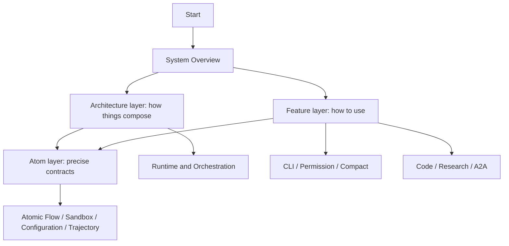

# Yiku Documentation

This directory describes only the current implementation. The documentation is organized by architecture layer, feature layer, and atom layer, not by version, target state, or migration stage. When the source code conflicts with the documentation, the public entry points and automated tests take precedence.

## Reading Paths

Suggested first reading:

1. [System Overview](architecture/system-overview.md)
2. [Package Boundaries](architecture/package-boundaries.md)
3. [Runtime and Orchestration](architecture/runtime-and-orchestration.md)
4. [CLI](features/cli.md)
5. [Permission and Execution Boundaries](features/permissions.md)
6. [Agent-to-Agent and Subagents](features/subagents.md)
7. [Atomic Flow](atoms/atomic-flow.md) and [Trajectory](atoms/trajectory.md)

## Content Boundaries

| Location | Owns | Does Not Contain |
| --- | --- | --- |
| `architecture/` | Cross-package composition, dependency directions, lifecycle, and engineering invariants | Complete operation manuals for individual features |
| `features/` | Capabilities, configuration, and failure semantics directly usable by users or hosts | Field-by-field definitions of underlying protocols |
| `atoms/` | Foundational protocols, stable types, storage, and algorithm boundaries | Concrete host UI and product flows |
| `packages/*/README.md` | Package-level positioning, minimal examples, and verification commands | Duplicated system-level explanations |
| `superpowers/` | Design and implementation process records | Authoritative explanations of the current implementation |

## Architecture Layer

The architecture layer explains cross-package relationships, dependency directions, runtime lifecycle, and engineering invariants.

- [System Overview](architecture/system-overview.md)
- [Package Boundaries](architecture/package-boundaries.md)
- [Runtime and Orchestration](architecture/runtime-and-orchestration.md)
- [Observability](architecture/observability.md)
- [Engineering](architecture/engineering.md)

## Feature Layer

The feature layer organizes operations, public entry points, boundaries, failure semantics, and minimal examples by usable capability.

- [CLI](features/cli.md)
- [Code Agent](features/code-agent.md)
- [Research Agent](features/research-agent.md)
- [Agent-to-Agent and Subagents](features/subagents.md)
- [Context Compact](features/context-compaction.md)
- [Permission and Execution Boundaries](features/permissions.md)
- [Skills](features/skills.md)
- [Hooks](features/hooks.md)
- [Memories](features/memories.md)
- [Evals](features/evaluations.md)
- [Agent Studio](features/agent-studio.md)

## Atom Layer

The atom layer records foundational protocols, stable data structures, configuration storage, and underlying algorithms.

- [Atomic Flow](atoms/atomic-flow.md)
- [Atom Catalog](atoms/atom-catalog.md)
- [Configuration and Storage](atoms/configuration-and-storage.md)
- [Sandbox](atoms/sandbox.md)
- [Trajectory](atoms/trajectory.md)
- [Flow Graph](atoms/flow-graph.md)

## Site and Deployment

`site/` packages this directory and `artifacts/` into an online, accessible visual site, supporting two deployment paths: GitHub Pages and Vercel.

- [Site Deployment](deployment.md): local development, building, configuration steps for the two deployment methods, required permissions, and verification methods.

English translations of this directory live in `docs/en/` under the same relative paths. The site build collects them per language and falls back to the Chinese source when an English doc is missing; switching the language only affects the site chrome and doc bodies, not the artifact data.

## Capability Mapping

| Requirement | Documentation |
| --- | --- |
| Startup, arguments, Slash Command, non-interactive output | [CLI](features/cli.md) |
| Modifying code and running commands | [Code Agent](features/code-agent.md) |
| Workspace authorization, command approval, Profile, Hook, and Sandbox | [Permission and Execution Boundaries](features/permissions.md) |
| Shell process isolation and platform boundaries | [Sandbox](atoms/sandbox.md) |
| Web Search, Evidence, Claim, and report verification | [Research Agent](features/research-agent.md) |
| Handoff, Delegate, A2A Envelope, Profile, and Worktree | [Agent-to-Agent and Subagents](features/subagents.md) |
| Automatic/manual context compaction, summaries, and events | [Context Compact](features/context-compaction.md) |
| Creating and running `SKILL.md` | [Skills](features/skills.md) |
| Lifecycle policies and Trust | [Hooks](features/hooks.md) |
| Long-term memory and recall | [Memories](features/memories.md) |
| Quality gates, repair, and Baseline | [Evals](features/evaluations.md) |
| Local Web observation and plugins | [Agent Studio](features/agent-studio.md) |
| Run Event, Replay, and Fold | [Atomic Flow](atoms/atomic-flow.md) |
| Trajectory generation, updates, storage boundaries, and applications | [Trajectory](atoms/trajectory.md) |
| Home, Workspace Storage, and configuration priority | [Configuration and Storage](atoms/configuration-and-storage.md) |

## Maintenance Index

| Topic | Primary Implementation | Primary Tests | Authoritative Documentation |
| --- | --- | --- | --- |
| Compact | `agent-orchestrator/src/session/compactor.ts`, `agent-orchestrator/src/session/context-budget.ts` | `agent-orchestrator/tests/session/compactor.test.ts`, `agent-orchestrator/tests/session/context-budget.test.ts` | [Context Compact](features/context-compaction.md) |
| Permission | `agents/code/src/permission/`, `cli/src/permission/`, `sandbox/src/` | `agents/code/tests/permission/`, `cli/tests/permission/`, `sandbox/tests/` | [Permission and Execution Boundaries](features/permissions.md) |
| Agent-to-Agent | `agent-orchestrator/src/tools/delegate-tool.ts`, `agent-orchestrator/src/agents/subagent-runtime.ts`, `agent-orchestrator/src/messages/` | `agent-orchestrator/tests/tools/`, `agent-orchestrator/tests/agents/`, `agent-orchestrator/tests/messages/` | [Agent-to-Agent and Subagents](features/subagents.md) |
| Memories | `memories/src/`, `agent-orchestrator/src/session/memory-runtime.ts` | `memories/tests/`, Orchestrator Memory Tests | [Memories](features/memories.md) |
| Evals | `evals/src/`, `agent-orchestrator/src/evals/` | `evals/tests/`, Orchestrator Eval Tests | [Evals](features/evaluations.md) |
| Trajectory | `trajectory/src/projection.ts`, `recorder.ts`, `trace.ts` | `trajectory/tests/`, Observatory Trajectory Tests | [Trajectory](atoms/trajectory.md) |

All paths in the table are relative to `packages/`. When modifying protocol fields, check the producer, projection adapter, persistence schema, consumer, and corresponding documentation together; changing only the UI or a single type is usually not enough to complete a protocol evolution.

## Documentation Rules

- Only one authoritative document per topic.
- API summaries and minimal examples live in the owning topic; do not duplicate public exports separately.
- Current limitations are written in the owning topic; do not keep future implementation plans.
- Do not commit static performance results from a single machine as long-term facts; keep reproducible commands and thresholds.
- Package READMEs provide only package-level quick entry points and link to this directory.
- `docs/superpowers` is a working process record and does not belong to the current project documentation navigation.

## Sharing Materials

- [Yiku Architecture Share Page](../artifacts/yiku-architecture-share.html): an interactive summary for presentations; system facts still follow this directory, the public exports, and the tests.
