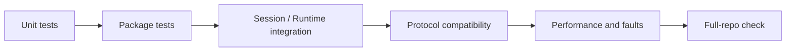

# Engineering

This document defines the development, testing, and release constraints of the Yiku Monorepo. For business boundaries, see [Package Boundaries](package-boundaries.md).

## Environment

- Node.js `>=22.13.0`
- `corepack`
- `pnpm`, with the version determined by the root `package.json`'s `packageManager`

Installation:

```bash
corepack pnpm install
```

## Common Commands

```bash
corepack pnpm build
corepack pnpm watch
corepack pnpm lint
corepack pnpm test
corepack pnpm check
```

- `build` uses TypeScript Project References and builds the Agent Observatory Web assets.
- `watch` starts incremental TypeScript compilation for each formal Package in parallel.
- `lint` uses Biome.
- `test` uses Vitest and V8 Coverage.
- `check` runs lint, build, and test in order.

ESLint and Prettier do not participate in this repository's gates.

## Code Conventions

- Use relative imports only; do not introduce path aliases.
- `index.ts` is responsible only for exports.
- Frontend files use lowercase kebab-case, and functions use camelCase.
- Prefer small modules and local `types.ts`.
- Prompt templates, rendering, and Prompt-specific UI are owned by the Package that uses them.
- CLI UI does not enter Agent packages or the Orchestrator.
- Agent packages do not execute Sessions.
- Do not generate `.js.map` or `.d.ts.map`.
- `packages/cli/bin/yiku.js` always starts `dist/index.js`.
- Documentation prose defaults to Chinese; identifiers such as package names, config keys, commands, paths, type names, and UI spec names remain in their original English. When rewriting documentation, you must check the source code to confirm default values and failure semantics. See the documentation language conventions in `AGENTS.md`.

## Package Development

Each formal Package provides at least:

```json
{
  "scripts": {
    "build": "tsc -b",
    "test": "vitest run ...",
    "watch": "tsc -b --watch --preserveWatchOutput"
  }
}
```

When adding a Package:

1. Configure an independent `tsconfig.json` and a root Project Reference;
2. Ensure the path is discoverable in `pnpm-workspace.yaml`;
3. Expose stable entry points only through the Package's `exports`;
4. Declare internal dependencies with `workspace:*`;
5. Add a package-level README, test script, and watch script;
6. Check that dependency directions do not violate package boundaries.

## Test Structure

Formal Package tests live in the package-level `tests` directory and mirror `src`:

```text
package/
├── src/feature/module.ts
└── tests/feature/module.test.ts
```

Data and DOM tests for frontend Packages also go in the corresponding mirror directory under `tests`. Test-specific Fixtures and Helpers must stay in the corresponding test directory; production code must not depend on test files.

Tests should cover:

- Normal paths and boundary inputs;
- Runtime invalid data beyond types;
- Timeouts, aborts, and resource cleanup;
- Filesystem, network, Provider, and Store failures;
- Concurrency, idempotency, and Revision conflicts;
- Permissions, paths, symbolic links, and data redaction;
- Protocol serialization, replay, and compatibility Fixtures.

## Coverage

Root tests use V8 Coverage. Statement, branch, function, and line coverage must not fall below 90%. Pure type files and export-only `index.ts` files are not counted toward coverage.

Package tests must not depend by default on the public internet, user configuration, or existing Home data. When environment capabilities are needed, use temporary directories, Fixtures, Fake Providers, or explicit injection.

## Layered Gates



- Unit: pure functions, data structures, and error boundaries.
- Package: public API and resource ownership.
- Integration: Session, Runtime, Agent, Hook, Memory, Eval, and Studio composition.
- Conformance: Hook, Atomic Flow, Store, Schema, and external compatibility protocols.
- Performance: after warm-up, use P95 and resource limits; do not judge by the fastest single result.

## Hooks Compatibility Gates

The Hooks compatibility baseline is defined by `CLAUDE_HOOKS_COMPATIBILITY_VERSION` and local Manifest/Fixtures. The current protocol includes 30 events; the Runtime wires in 28, with `WorktreeCreate` and `WorktreeRemove` returning an explicit `HOOK_CAPABILITY_UNAVAILABLE`; they must not be silently ignored.

When changing Hook events, Handlers, output, or Exit Code behavior, verify in order:

1. Schema Fixture;
2. Callback, Command, HTTP, Prompt, Agent, and MCP Executors;
3. Runtime lifecycle boundaries;
4. Trust, SSRF, paths, resource limits, and redaction;
5. P95 performance with no matching Hook;
6. Full-repository gates.

```bash
corepack pnpm --filter @yiku/hooks test
corepack pnpm --filter @yiku/agent-orchestrator test
corepack pnpm --filter @yiku/cli test
```

## Performance Testing

Evals provides reproducible local performance scripts:

```bash
corepack pnpm --filter @yiku/evals build
corepack pnpm --filter @yiku/evals performance
```

The default gates include:

- 32-Check scheduling P95 under 100 ms;
- File Store commit P95 under 50 ms;
- RSS growth under 256 MiB.

Results are affected by CPU, filesystem, and Runner. CI should maintain its own approved Baseline in a fixed environment; do not commit static results from a single development machine as long-term facts.

## Release

The root Package is not published. Formal Packages all use ESM and conditional `exports`, providing at least `development`, `types`, and `import` entry points. Before release, run:

```bash
corepack pnpm check
```

Release checks:

- `dist` contains no Source Map or Declaration Map;
- All public entry points have generated `.js` and `.d.ts`;
- Internal dependency versions come from the Workspace;
- README links and examples use public entry points;
- The minimum Node.js version covers runtime dependencies such as `node:sqlite`;
- `.env`, Home data, Session, Memory, or test temporary files are not packaged.

## Documentation Maintenance

`docs` is maintained by architecture layer, feature layer, and atom layer. When source code and documentation conflict, the public entry points and tests take precedence. When adding capabilities, update the single owning topic; do not create duplicate documents classified by version, migration stage, or future roadmap.

When adding or splitting a formal Package, sync in the following order:

1. Update the owning feature or atom documentation, clarifying the entry point, ownership, failure semantics, and resource cleanup responsibility;
2. Update the direct Workspace dependencies and boundary invariants in [Package Boundaries](package-boundaries.md);
3. Update the capability map and main chain in [System Overview](system-overview.md);
4. Keep short entry points in the root README and Package README, linking to the single authoritative topic;
5. If system relationships or public sharing content change, sync `artifacts/yiku-architecture-share.html`.

The share page is presentation material, not a new source of truth. Repository metrics, Package counts, and dependency tables must be re-verified from the current checkout; do not reuse old snapshots.
