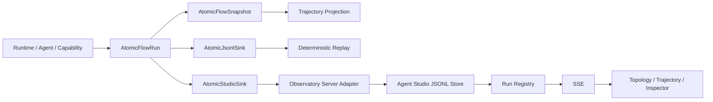

# Observability

Yiku uses Atomic Flow to record runtime facts, then generates Trajectory, persistent logs, and Agent Studio views from the same event stream. Execution and observability are isolated from each other: observability failures are marked as degraded but should not stop the originating Agent Run.

## Source of Truth and Projections



Constraints:

- Atomic Flow Events are the sole observability fact for a standard Run.
- Trajectory does not maintain a second set of execution state; it only projects from Event prefixes.
- Agent Studio's Run Metadata is a projection that can be rebuilt from JSONL Events.
- UI state does not control the originating Agent in reverse.

## Run Boundaries

A single top-level Prompt corresponds to a unique `runId`. A Session's multiple Stages share the Session identity, but each top-level submission uses an independent Run. Run Metadata contains:

- `kind`: `agent` or `control`;
- Session, Agent, and Prompt summaries;
- Project ID and name;
- Creation time and current status.

Atomic Flow assigns strictly increasing Sequences within a single Run. An Atom Key represents a stable flow node, and an Instance ID represents one concrete execution of that node.

## Sink

### JSONL

`AtomicJsonlSink` appends the complete event history. After reading, `foldAtomicEvents()` rebuilds the Snapshot. The internal Sink Receipt is written only once to avoid recursively generating observability events.

### Studio

`AtomicStudioSink` delivers Events and Run Metadata to a loopback HTTP endpoint. It accepts only local addresses. On delivery failure:

- The originating Flow continues running;
- The Snapshot is marked `degraded`;
- A stable degradation code is added;
- Receipts and Sink Errors are emitted as visible Trace events only when `flow.trace: true`.

## Trajectory

`@yiku/trajectory` provides static and real-time projections:

- `projectTrajectory(events)`: generates the final trajectory from an Event array;
- `observeTrajectory(flow)`: subscribes to the Flow to generate a real-time Snapshot;
- `throughSequence`: projects any Replay prefix;
- Text, Markdown, and Mermaid Renderers;
- Compatible `Trace` and `TrajectoryRecorder`.

Trajectories preserve Parent/Child, status, Iteration, summaries, and durations. A missing Parent or an invalid hierarchy degrades to readable root-level steps without fabricating causal relationships.

## Agent Studio

`@yiku/agent-studio` provides protocol-agnostic server and React hosts:

- The Event Adapter converts external protocols into `StudioEvent`;
- The Run Projector updates state and extended data;
- The JSONL Store and Run Registry manage persistent history;
- The HTTP API provides Health, Manifest, Run, and Event;
- SSE pushes incremental events;
- Client plugins contribute Page, Navigation, Slot, Renderer, Graph, Action, and Theme Token.

Plugin dependencies, versions, and duplicate contributions are validated at startup. Server plugin Routes are mounted at `/api/plugins/<plugin-id>/*`.

## Agent Observatory

`@yiku/agent-observatory` is the default Studio plugin for Atomic Flow. It provides:

- Run history and auto-follow;
- Runtime and domain Atom Topology;
- Topology/Trajectory dual views;
- Event Log, Inspector, and message details;
- Live, single-step, and variable-speed Replay;
- Agent, Skill, Subagent, Memory, Telemetry, and Eval partitions;
- Dynamic Agent namespaces;
- `?runId=<id>&view=trajectory` deep links.

`yiku web --port <port>` starts the Observatory and continues the interactive session in the same terminal. Exiting the terminal closes this Web service. `yiku web --stop` only cleans up registered old background observers.

## Graph Layout

The Observatory uses `@yiku/flow-graph` for ports, obstacles, and orthogonal paths. Node business partitioning and coordinates are decided by the Observatory; the routing package only returns geometric results and diagnostics. Explicit Event Edges take precedence; when absent, the UI uses limited adjacent-event inference.

## Persistence

The Run history of Yiku Observatory lives at:

```text
~/.yiku/workspaces/<workspace>/logs/runs/
```

The source Atomic Flow JSONL lives at:

```text
~/.yiku/workspaces/<workspace>/logs/atomic-runs/
```

The generic `StudioServer` uses the host `workspaceDir/.yiku/studio-runs` when no Store is injected. The Yiku CLI injects the Workspace Store under Home through the Observatory plugin, so the in-project default path is not used.

## Security and Degradation

- The Studio Server allows binding only to `127.0.0.1` or `localhost` by default.
- The Ingest Body has a size limit, and plugin Route errors return a stable Code and Request ID.
- After SSE disconnection, the client re-fetches the Run and then resumes the incremental subscription.
- Corrupt or missing compatibility Traces return empty results; Atomic JSONL protocol errors fail explicitly.
- UI, Sink, or Renderer errors cannot obtain Runtime permissions.

## Related Documentation

- [Agent Studio](../features/agent-studio.md)
- [Atomic Flow](../atoms/atomic-flow.md)
- [Atom Catalog](../atoms/atom-catalog.md)
- [Trajectory](../atoms/trajectory.md)
- [Flow Graph](../atoms/flow-graph.md)
