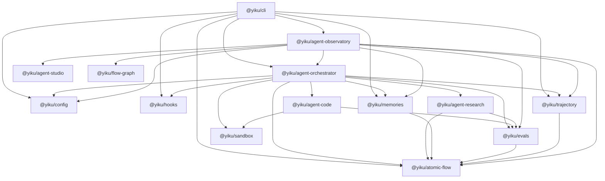

# Package Boundaries

Yiku splits hosts, execution orchestration, Agent capabilities, policy services, observability protocols, and presentation into separate packages. Higher-level packages may compose lower-level packages; foundational protocols must not depend in reverse on the CLI or concrete Agents.

## Complete Dependency Directions

The diagram expresses the complete Workspace production dependencies of the formal Packages. There are currently no Workspace package cycles and no production cross-package imports that are not declared in `package.json`. `@yiku/agent-studio`, `@yiku/atomic-flow`, `@yiku/config`, `@yiku/flow-graph`, `@yiku/hooks`, and `@yiku/sandbox` do not depend on other Workspace packages.

The Observatory reuses the Atom definitions and projection capabilities of the Orchestrator, Memory, Eval, and Trajectory, but these dependencies must not let Studio bind in reverse to Yiku business protocols.

| Package | Direct Workspace Dependencies |
| --- | --- |
| `@yiku/cli` | Agent Observatory, Agent Orchestrator, Atomic Flow, Config, Hooks, Memories, Trajectory |
| `@yiku/agent-observatory` | Agent Orchestrator, Agent Studio, Atomic Flow, Config, Evals, Flow Graph, Memories, Trajectory |
| `@yiku/agent-orchestrator` | Agent Code, Agent Research, Atomic Flow, Config, Evals, Hooks, Memories, Sandbox, Trajectory |
| `@yiku/agent-code` | Evals, Sandbox |
| `@yiku/agent-research` | Atomic Flow, Evals |
| `@yiku/evals` | Atomic Flow |
| `@yiku/memories` | Atomic Flow |
| `@yiku/trajectory` | Atomic Flow |
| `@yiku/agent-studio`, `@yiku/atomic-flow`, `@yiku/config`, `@yiku/flow-graph`, `@yiku/hooks`, `@yiku/sandbox` | None |

## Code-Level Composition

Inside the package boundaries there is still a layer of module-level composition. The current implementation is not "one independent Primitive per directory"; instead it is delivered by a few stable Primitive packages together with one larger product composition root:

| Package | Primary Internal Modules | Current Composition Semantics |
| --- | --- | --- |
| `@yiku/agent-orchestrator` | `runtime`, `session`, `agents`, `skills`, `tasks`, `mcp`, `workspace`, `openai`, `messages`, `evals` | Contains execution adaptation, persistent Session, and the Yiku default product assembly together |
| `@yiku/agent-code` | `tools`, `permission`, `prompts`, `models`, `evals` | The Code Agent and reusable code tools are currently published in the same package |
| `@yiku/sandbox` | Platform isolation, launch description, availability probes | A Shell process isolation Primitive with no Agent dependency |
| `@yiku/agent-research` | `evidence`, `tools`, `flow`, `prompts`, `models`, `evals` | The Research Agent and evidence primitives are currently published in the same package |
| `@yiku/cli` | `agent-session`, `app`, `slash-commands`, `permission`, `prompts`, `services` | Host UI and default Runtime startup assembly live in the same package |
| `@yiku/agent-observatory` | Browser UI, Atomic projection, Studio plugin, compatibility Server | The default observability plugin and legacy compatibility entry points are published in the same package |

`AgentFactoryRegistry` is the current Agent extension point. When no Registry is passed, the Orchestrator's Agent Graph construction registers `CodeAgentFactory` and `ResearchAgentFactory`; the CLI's persistent Session startup also explicitly registers the same set of default Factories. Therefore `@yiku/agent-orchestrator` is currently a composition root with default business implementations, not a Runtime Kernel containing only abstract contracts.

The general Tool lifecycle contract, Permission, User Question, and Workspace Access are currently defined by `@yiku/agent-code` and then re-exported and consumed by the Orchestrator. This is the true ownership of the current public API, and it also means a custom Orchestrator host that does not use the Code Agent still installs the Code Agent package.

## Host Layer

### `@yiku/cli`

Owns the `yiku` binary, argument parsing, TTY authorization, Ink UI, Prompt editing, completion, Slash Commands, approvals, the timeline, and structured output. It delegates execution to the Orchestrator and does not define the Agent Runner or persistent Session protocol.

### `@yiku/agent-studio`

Provides a protocol-agnostic Run/Event model, JSONL Store, Run Registry, HTTP/SSE Server, React Shell, and plugin contribution points. It does not know about Atomic Flow, Memory, Eval, Trajectory, or concrete Agents.

### `@yiku/agent-observatory`

The default Studio plugin and local Web preset for Yiku. It adapts Atomic Flow into Studio Events and provides Topology, Trajectory, Replay, Inspector, and compatibility server entry points.

## Current Host Integration

There are currently three integration depths:

| Integration Method | Entry Point | Scope |
| --- | --- | --- |
| Single-turn Node host | `runAgentSession()` | Compatibility entry point that automatically creates and closes the Session |
| Multi-turn Node host | `AgentSession` / `SessionRuntime` | Direct injection of Permission, User Question, Event, Store, and resource lifecycle |
| Low-level Agent execution | `AgentFactory` + `run()` | Self-managed configuration, Factory, storage, Hook, Memory, and Eval assembly |

The CLI isolates the Ink UI and the concrete Session implementation through the in-package `CliAgentSessionContract`, but this Contract belongs to the CLI, includes model switching, Slash Commands, export, and management operations, and is not a public host protocol shared across CLI/Web.

The Research Playground directly uses the low-level Factory and `run()`, implementing its own configuration loading and result adaptation.

The CLI does not implement the recursive Agent Graph construction algorithm, but it still explicitly registers the default Code/Research Factories today and reads the Agent Graph to assemble Hook, Eval, and presentation information. The default Factory policy therefore exists in both the CLI and the Orchestrator; this is current composition-root duplication, not an extension approach recommended for new hosts to copy.

Agent Observatory is a read-only observability Web; it does not create, submit, or cancel Agent Sessions from the browser. The repository currently has no browser-safe, transport-agnostic Session Command/Event protocol, so a Web Agent host cannot directly reuse `CliAgentSessionContract`.

## Execution Layer

### `@yiku/agent-orchestrator`

The only package responsible for building and running complete Agent Sessions. It parses configuration, builds the Agent Graph, calls the OpenAI Agents SDK, assembles Capabilities, persists Sessions, schedules Hook/Memory/Eval, and maintains Atomic Flow.

### `@yiku/agent-code`

Defines `CodeAgent`, Prompts, Code Skill, Workspace tools, the permission protocol, Shell Policy, and Code Eval. It consumes the process isolation contract of `@yiku/sandbox` and does not own platform isolation implementation, Session, model configuration, Handoff orchestration, or CLI presentation.

### `@yiku/sandbox`

Compiles authorized Workspaces, network policies, and runtime read-only paths into macOS Sandbox Profiles or Linux `bubblewrap` launch descriptions. It does not parse commands, approve permissions, start child processes, or execute Agent Sessions. When platform capabilities are unavailable, it returns a stable error and does not degrade to the Host Shell on its own.

### `@yiku/agent-research`

Defines `ResearchAgent`, Research Skill, Web Search composition, Evidence/Claim Ledger, report verification, Research Eval, and domain atoms. It does not own Session, CLI, or code workspace tools.

## Policy and Service Layer

### `@yiku/config`

Reads and merges YAML and `.env` and resolves `~/.yiku` and Workspace Storage paths. Final Agent, Runtime, and Eval semantics are resolved by the Orchestrator.

### `@yiku/hooks`

Owns Hook events, configuration compilation, matching, six Executor types, Decision, Trust, and safety limits. It does not depend on the Orchestrator, Agent SDK, CLI, or Atomic Flow.

### `@yiku/memories`

Owns partitioned long-term memory, Policy, Extraction Contract, SQLite/FTS, optional vector retrieval, reranking, and safe context rendering. It can be used independently of the Agent Runtime.

### `@yiku/evals`

Owns Profile, Plan, Evaluator Registry, DAG Scheduler, Scorecard, Baseline, and the result Store. It evaluates completed run inputs; it does not execute Agents or independently decide Session final states.

## Foundation Protocol Layer

### `@yiku/atomic-flow`

Owns Run-level events, Span, Edge, Sequence, Sink, JSONL, and Fold. It does not execute Agents, does not interpret domain results, and does not depend on any Yiku business package.

### `@yiku/trajectory`

Projects Atomic Flow into hierarchical execution trajectories and provides Text, Markdown, Mermaid, and JSONL Trace capabilities. Trajectory is a derived view, not a source of runtime facts.

### `@yiku/flow-graph`

Provides port assignment, orthogonal routing, obstacle avoidance, path optimization, SVG Path, and diagnostics for rectangular nodes. It does not depend on React, DOM, Atomic Flow, or business semantics.

## Boundary Invariants

- Only the Orchestrator runs complete Agent Sessions.
- Agent packages define capabilities; they do not own host UI or Session lifecycle.
- The CLI does not implement recursive Agent Graph construction or Runtime Policy; the current default Factory registration is still host assembly to be consolidated.
- Agent Studio does not depend on any Yiku business protocol.
- The Observatory extends through Studio's public plugin, Store, and Registry contracts.
- Atomic Flow is the single source of truth for runtime observability; Trajectory and Studio Runs are projections.
- Flow Graph handles only geometry and routing; it does not decide business nodes, colors, or run states.
- A Hook's `allow` cannot override the Runtime's `deny`.
- Sandbox implements only process isolation; command policies, permission approval, and Host Policy degradation are explicitly owned by the caller.
- The Agent Observer uses the caller-provided Flow and does not create or close Sinks.
- Prompt templates and dedicated rendering are owned by the package that uses them; Prompt modules are not shared across packages.
- `index.ts` is responsible only for public exports; packages collaborate through public entry points.

## Current Boundary Debt

- The general Permission, User Question, Tool Effect, and Workspace Access contracts are still defined by `@yiku/agent-code`, so the Orchestrator must install the Code Agent package even if the host only runs other Agents.
- The Orchestrator contains both the Runtime Kernel and the Yiku default Code/Research product assembly; the CLI in turn registers the default Factory again. When adding a built-in Agent, both composition locations must be checked in step.
- `@yiku/evals` currently defines `ResearchClaimRecord`, `ResearchClaimManifest`, and Research Artifact Kinds; the general evaluation protocol is still bound to Research domain types.
- `@yiku/atomic-flow` currently embeds the HTTP path of `AtomicStudioSink` and Studio Run Metadata; the fact protocol and the default observability transport are not yet fully separated.
- Agent Observatory depends directly on multiple domain Atom Catalogs. The protocol-agnostic boundary is `@yiku/agent-studio`, not the Observatory.

These entries describe current code ownership; they do not mean foundational packages are allowed to keep introducing the CLI, presentation components, or new concrete Agent protocols.

## Extension Points

| Extension Target | Boundary to Use |
| --- | --- |
| New Agent type | Agent package + Orchestrator `AgentFactory` |
| New Node host | `AgentSession` or `SessionRuntime` + host interaction Handler |
| New CLI operation | CLI Slash Command or host entry point |
| New lifecycle policy | `@yiku/hooks` Handler/Executor |
| New external tool | Skill or MCP, then authorized via `CapabilityScope` |
| New evaluator | `@yiku/evals` Registry and Profile |
| New Shell isolation platform | The `ShellProcessSandbox` contract of `@yiku/sandbox` |
| New observability page or Renderer | Agent Studio client plugin |
| New event protocol adaptation | Agent Studio server-side Adapter/Projector |
| New flow atom | Domain package defines the Atom; Orchestrator/Observer emits |

For runtime relationships, see [Runtime and Orchestration](runtime-and-orchestration.md); for observability projection, see [Observability](observability.md).
