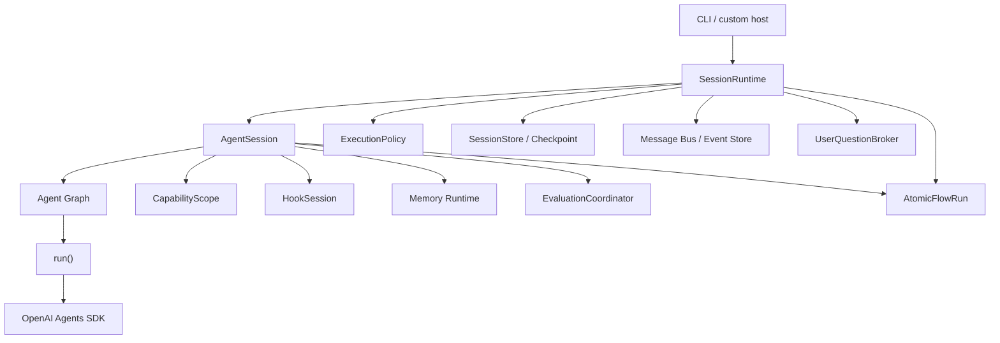
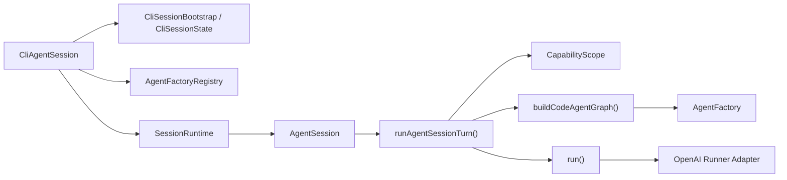
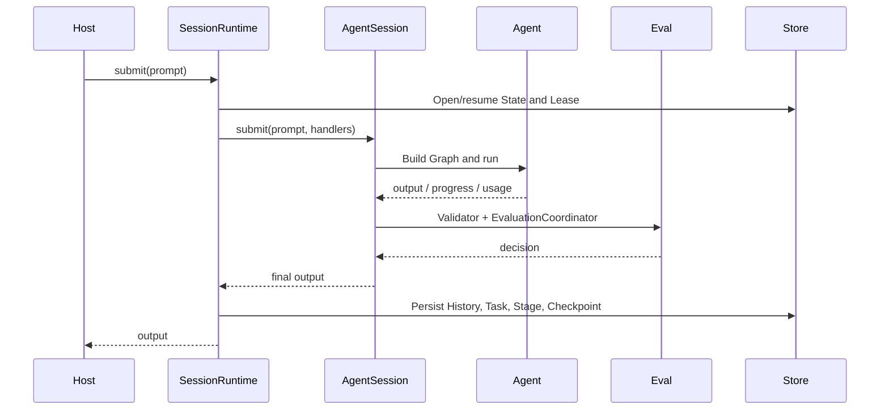

# Runtime and Orchestration

`@yiku/agent-orchestrator` is Yiku's execution composition root. It connects configuration, Agents, tools, Session, Task, Hook, Memory, Eval, and Atomic Flow into a cancelable, resumable, observable run.

## Layering



### `run()`

The lowest-level Runner Adapter. It executes an already-built OpenAI Agent, handling model calls, Tools, Handoffs, cancellation, usage, and generic Runtime Atoms. It does not parse project configuration and does not own persistent Sessions.

### `AgentSession`

The execution entry point for a single logical session. It resolves the Agent Graph, assembles the Capabilities, permissions, Hooks, Memory, and Evals for this Submit, and supports multiple `submit()` calls.

### `SessionRuntime`

The composition root for long-running tasks. It maintains Stage, budgets, Session State, Checkpoint, Task, messages, Trace, user questions, compaction, and recovery. The CLI holds one Runtime and closes its resources uniformly on exit.

## Code-Level Execution Chain

The assembly of a persistent CLI Session currently spans the following entry points:



- `CliSessionBootstrap` reads user and project configuration, discovers Skills, and opens the persistent Session State;
- `CliAgentSession` creates Hook, Permission Profile, MCP, Memory, Eval, Agent management, and Checkpoint resources;
- `SessionRuntime` handles Stage, recovery, messages, and user questions;
- `AgentSession` handles Hook, Prompt Expansion, History, and Transcript;
- `runAgentSessionTurn()` handles the Memory, Capability, Agent Graph, Runner, and Eval for a single Turn;
- `run()` only executes an already-built Agent and writes Provider events into Atomic Flow.

This chain explains why the public API offers four granularities at once: `run()`, `runAgentSessionTurn()`, `AgentSession`, and `SessionRuntime`. They are not synonymous wrappers: the lower the level, the more resources and policies the caller must handle itself.

## Configuration Resolution

User configuration `~/.yiku/config.yaml` and project configuration `./config.yaml` are deeply merged, with project values taking precedence. Before startup, the Orchestrator resolves and validates:

- `models`: model names, API Key environment variables, Base URL, and Context Window;
- `agents`: default Agent, type, model, Skills, Handoffs, and Delegates;
- `skills`: instructions and allowed MCP Targets;
- `mcp`: `stdio` or `streamable-http` Servers;
- `runtime`: Stage, Turn, Tool, time, compaction, and concurrency budgets;
- `memory`: enablement, extraction, and failure modes;
- `flow`: whether Trace Receipts enter the event stream;
- `evals`: mode, Profile, concurrency, thresholds, repair, and Verification Command.

Unknown fields, invalid references, and capabilities forbidden by Managed Policy fail before the run. See [Configuration and Storage](../atoms/configuration-and-storage.md) for configuration details.

## Session Lifecycle



A single top-level Prompt corresponds to one Atomic Flow Run. Long-running tasks may contain multiple Stages while keeping the same Session identity. A Stage ends or pauses when:

- Normal completion;
- Turn, Tool, time, or no-progress budgets are reached;
- Waiting for user input or approval;
- User cancellation;
- Provider, tool, Hook, Validator, or Eval failure.

`autoContinue` allows the Runtime to start the next Stage after a resumable stop reason. Cross-process recovery only starts from persisted stable Stage boundaries and does not serialize the SDK's internal `RunState`. A waiting User Question is persisted as Pending Input; on recovery, depending on the Provider Continuation Capability, an explicitly marked reconstructed continuation is used, or the state is kept as `needs-review`.

## Agent Graph

The Agent Graph is composed of Agent definitions from the configuration. Each node specifies:

- `type`: built-in `code`, `research`, or a registered custom Factory;
- `model`: model configuration key;
- `skills`: capabilities visible to that Agent;
- `handoffs`: native SDK control-transfer targets;
- `delegates`: subtask targets invoked by tools.

`AgentFactoryRegistry` builds Agents by type. `CodeAgentFactory` and `ResearchAgentFactory` are the built-in implementations. Factories may return domain `AgentRunObserver` and `AgentOutputValidator`; when no Observer is provided, the generic Runtime Flow is still received.

The Graph selects the Factory by each node's own `type`. The caller-provided `agentType`, `modelKey`, and temporarily activated Skills override only the root node and do not propagate to Handoffs; a Handoff continues to use its own Type, Model, and Skill configuration. When the Code Agent does not declare `skills`, it by default receives `agents + code + skills + tasks`; other Agents by default receive only the generic Skill Catalog, and domain tools are created by their respective Factories.

`AgentFactoryInput.tools` is the host tool contract already narrowed by the Orchestrator according to the Capability Scope. Factories must preserve these tools and compose them with their own domain tools; the Research Factory therefore composes:

```text
web_search + recordEvidenceTool + recordResearchClaimTool
+ skillListTool + skillInspectTool + skillRunTool
+ Agent 显式声明的 MCP / Delegate / 其他受限工具
```

The composed Tool Names must be unique. Research does not receive Code Workspace tools by default; additional tools enter the Scope only when the host explicitly declares them in the Agent configuration and they pass Permission, Workspace Access, and Managed Policy.

## Handoff, Delegate, and Session Subagent

The three collaboration mechanisms have different semantics:

| Mechanism | Lifecycle | Control | Typical Use |
| --- | --- | --- | --- |
| Handoff | Current SDK Run | Transferred to the target Agent | Specialized routing |
| Delegate | Tool Call within the current task | The parent Agent continues after waiting for the result | Bounded parallel subtasks |
| Session Subagent | Session-persistent Profile/Instance | Explicitly started by the management service | Reusable expert roles |

Delegate supports read-only, shared read-write, and Worktree isolation. Shared writes are serialized via `WorkspaceWriteLock`; Worktrees are created, diffed, and cleaned up by `WorktreeManager`. External side effects are not part of the local transaction, and recovery may require `completed`, `retry`, or `abandon` review.

See [Subagents](../features/subagents.md) for full usage.

## Capability Scope

`CapabilityScope` assembles capabilities according to the Agent configuration:

- Code Toolset;
- Task and TODO Adapter;
- Delegate;
- Agent management;
- Skill Runtime;
- MCP Tool;
- User Question;
- Permission Handler.

Capabilities take the intersection of Agent declarations, Skill Snapshot, MCP allowlist, Workspace Access, and Managed Policy. Project content cannot elevate host permissions by itself through configuration.

### Generic Skill Assembly

The `SKILL.md` chain for a persistent CLI Session is as follows:

```text
builtin / ~/.yiku / <workspace>/.yiku
  -> discoverSkills()
  -> SkillRuntime Catalog
  -> createSkillRuntimeSkill(agentType)
  -> CapabilityScope 的 "skills"
  -> AgentFactoryInput.tools
  -> CodeAgentFactory / ResearchAgentFactory
```

The Catalog always keeps only the name, description, and compatible Agent Types. `skillInspectTool` returns the body and Skill Root on demand; `skillRunTool` first generates a Snapshot according to the current Agent Type and MCP Policy, then executes it in an independent read-only `runAgentSessionTurn()`. When a Slash Command activates a discovered Skill, it also runs the same Agent Type and Capability validation first.

## Prompt Trust Boundaries

The Runtime uses `PromptSegment` to preserve the context source, type, trust level, optional Source ID, and Digest. Only host-explicitly-provided Runtime/User Instructions may enter the Agent System Instructions. The following content is uniformly treated as bounded `untrusted` User-level Reference input:

- Conversation History and model-generated compaction summaries;
- Workspace Instructions, project `config.yaml` / `.env` Instructions;
- Project Skill, Project/Session Agent Profile;
- Hook Additional Context and Memory Recall;
- Tool, MCP, Hosted Web Search, Shell, and Apply Patch output.

Reference content is XML-escaped and carries declarations that it cannot override Runtime Instructions, cannot elevate permissions, and cannot expand Tool Scope. The OpenAI Runner re-wraps Tool Results before every model call, so the CLI/Trace can keep the original presentation while the model only reads the boundary-protected copy.

`PromptGuard` rejects empty input, abnormal control characters, and Prompts/Segments over budget, and emits a `prompt_risk_detected` signal that does not include the original text for common instruction-override, prompt-theft, role-replacement, and tool-coercion features. This detection only provides a risk signal; whether to block is still decided by the Managed Hook or host Policy, and Tool Permission and Workspace Boundary are always enforced independently.

## Hook, Memory, and Eval Ordering

The key ordering is as follows:

1. Session/Prompt Hooks run at the corresponding lifecycle boundaries;
2. Memory Recall completes before the Agent context is built;
3. Tool Hooks surround Tool calls before and after side effects;
4. Domain Validators run after Agent output is produced;
5. Industrial Evals read the final output, Artifact, Receipt, Research Manifest, and Atomic Snapshot;
6. The Completion Policy decides `accepted`, `degraded`, `retry`, `needs-review`, or `rejected`;
7. Only `accepted` output automatically enters Memory Extraction/Promotion; when industrial Evals are not enabled, successful output that passes the Validator first extracts Memory, then runs the compatibility Eval.

The CLI uses `enforce` by default. One automatic repair keeps the same Task, creates a new Attempt, and is limited by the Profile's `maxRepairAttempts`.

Context Compact is independent of Memory: the former replaces the Conversation History sent to the model, while the latter manages Working and long-term knowledge. Automatic compaction happens only at resumable Stage boundaries and synchronizes Session State after success. See [Context Compact](../features/context-compaction.md) for details.

## User Interaction

`UserQuestionBroker` converts Tool-initiated questions into host requests. While waiting for an answer, the Stage Deadline pauses; after an answer, the same Submit continues. Non-interactive mode accepts only trusted Manifests, explicit answer files, or inputs overridden by Managed Policy; when authorization is missing, it fails closed and does not automatically select the first option.

Permission approval, Hook Trust, MCP Elicitation, and recovery review are all provided by the host via handlers; the Orchestrator does not render UI directly.

## Host Events and Interaction Contracts

The Runtime currently maintains two event representations:

- `AgentProgressEvent`: the union type used by the CLI and compatibility callers;
- `AgentMessageEnvelope`: the message protocol with `eventId`, timestamps, and Agent/Session/Task correlation information.

`progressEventToEnvelope()` and `envelopeToProgressEvent()` project between the two. A persistent Session can write Envelopes to the `AgentEventStore`, while the CLI still primarily consumes Progress Events. Memory's `memory_operation` and Sandbox's `runtime_boundary_changed` use the same exit, so Session JSONL, Trace, host callbacks, and Atomic Flow can be correlated by Session/Run. Memory Events do not carry Prompts, replies, or memory text; Sandbox boundary changes are projected in Atomic Flow as `runtime.boundary`.

The request/response types for Permission, Workspace write authorization, and User Question currently come from `@yiku/agent-code`. Hosts integrate via Handler callbacks; while waiting for user answers, `SessionRuntime` uses `UserQuestionBroker` to manage pause, answer, and cancel, and writes the Pending Question into Session State v5. This interface is suited to in-process Node calls, but there is currently no corresponding HTTP/SSE Command protocol.

Subagent messages use `AgentMessageEnvelope` and establish parent-child correlation through `agentId`, `agentSessionId`, `parentAgentId`, `parentToolCallId`, and `taskId`; messages with the same `agentId` are serialized in publication order. See [Agent-to-Agent and Subagents](../features/subagents.md) for the full protocol and [Permission and Execution Boundaries](../features/permissions.md) for the permission decision chain.

## State and Recovery

Session State stores:

- History and Context summaries;
- Stage, budget, and Continuation summaries;
- Task, Subagent Profile, and Instance;
- Summaries of completed and in-progress operations;
- Pending Question, Continuation Strategy, and Side-effect Review;
- Checkpoint and Workspace Snapshot references;
- Eval and working-memory related state.

Writes use the Session Store and Lease to prevent concurrent processes from owning the same Session at the same time. Workspace Checkpoint recovery overwrites files within the target snapshot's scope, so the CLI requires explicit confirmation before running `/rewind`.

## Public Entry Points

| Entry Point | Purpose |
| --- | --- |
| `run()` | Runs a built Agent |
| `runAgentSession()` | Single-turn compatibility entry point; automatically creates and closes the `AgentSession` |
| `AgentSession` | Multi-turn sessions, domain capabilities, and Eval |
| `SessionRuntime` | Persistent Session, Stage, recovery, and host integration |
| `resolveRuntimeConfig()` | Merges and validates Runtime configuration |
| `AgentFactoryRegistry` | Registers Agent types |
| `CapabilityScope` | Assembles restricted capabilities |
| `EvaluationCoordinator` | Runs Eval and repair flows |

Minimal host example:

```ts
import { runAgentSession } from "@yiku/agent-orchestrator";

const output = await runAgentSession("审查当前项目的错误处理", {
  agentKey: "code",
  cwd: process.cwd(),
});

console.log(output);
```

For long-term reuse, hold a `SessionRuntime` or `AgentSession` and call `close()` on exit.

## Errors and Resource Ownership

- Configuration errors are thrown before the Session is created.
- Cancellation signals propagate to the Runner, tools, Hooks, Evals, Store, and repair flows.
- Output Validator failure blocks standard Session completion.
- Eval `needs-review` and `rejected` are expressed via `EvaluationGateError`.
- Memory Managers, Atomic Flows, or external connections created by the caller are closed by the caller.
- Toolsets, MCP, Trace, Store, and message resources created by the Runtime itself are closed in reverse order.
- The CLI still registers the default Factory outside the Orchestrator today; custom hosts should use the Orchestrator's default Registry rather than copying the CLI composition logic.

## Related Documentation

- [Package Boundaries](package-boundaries.md)
- [CLI](../features/cli.md)
- [Agent-to-Agent and Subagents](../features/subagents.md)
- [Context Compact](../features/context-compaction.md)
- [Permission and Execution Boundaries](../features/permissions.md)
- [Hooks](../features/hooks.md)
- [Memories](../features/memories.md)
- [Evals](../features/evaluations.md)
- [Atomic Flow](../atoms/atomic-flow.md)
- [Trajectory](../atoms/trajectory.md)
