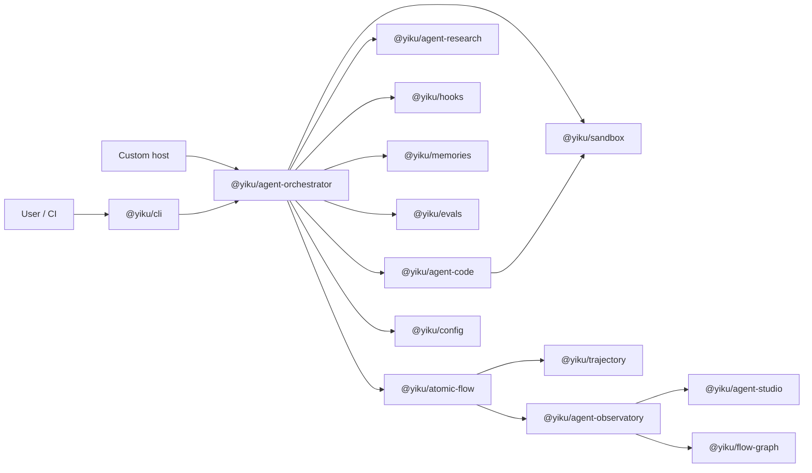

# System Overview

Yiku is a local Agent runtime platform for software engineering and evidence-based research tasks. It uses the Ink CLI as the default host, and the Orchestrator uniformly composes models, Agents, tools, Skills, Hooks, MCP, Memory, Evals, and observability capabilities.

## Core Goals

- Provide the same Agent Runtime for interactive and non-interactive tasks.
- Maintain Agent definitions, execution orchestration, foundational protocols, and presentation hosts separately.
- Execute code tools within Workspace boundaries and authorize risky commands and external side effects.
- Support long-running tasks through persistent Sessions, Checkpoints, Tasks, and Memory.
- Record runtime facts with Atomic Flow, and derive Trajectory and Agent Studio views.
- Perform explainable quality assessment and completion policies before task completion.

## System Relationships



## Host Model

Yiku's current Agent execution host is a Node process:

- The CLI holds a `SessionRuntime` in-process, implementing Ink interactions as Permission, User Question, Hook Trust, and MCP Elicitation Handlers;
- Custom Node hosts can use `runAgentSession()`, `AgentSession`, or `SessionRuntime` directly;
- The Research Playground uses `AgentFactory` and `run()` to assemble a single Research Run itself;
- Agent Observatory Web only consumes Atomic Flow; it does not create or control Agent Sessions.

Therefore, the CLI and low-level custom hosts share the Orchestrator, but the repository currently has no Session Command/Event protocol that both browser clients and the CLI depend on. When running Agents on the web, the server should hold the Runtime, browsers should only access it through controlled transport, and Workspace Tools, secrets, or authorization decisions must not be pushed directly down to the browser.

## Main Chain of a Task

1. The CLI parses arguments and confirms Workspace authorization in interactive mode; non-interactive mode requires existing authorization.
2. `@yiku/config` merges user and project configuration, and the Orchestrator validates model, Agent, Skill, MCP, Runtime, Memory, Flow, and Eval configuration.
3. `SessionRuntime` opens or resumes the Session, assembling persistent state, Tasks, Checkpoints, Memory, MCP, and the message bus.
4. `AgentSession` builds the Code, Research, or custom Agent according to the Agent Graph, and injects the permission and user-question handlers for this Submit.
5. The Runtime calls the OpenAI Agents SDK; tools, Handoffs, Delegates, Hooks, and user interactions all execute within a unified lifecycle.
6. Atomic Flow assigns ordered in-Run events for input, model, tools, Agents, Skills, Memory, Hooks, and Evals.
7. Successful output goes through domain Validators and Evals; the Completion Policy decides acceptance, degradation, retry, needs-review, or rejection.
8. The Session persists stage state and messages; Atomic Flow can be delivered to the local Agent Observatory, and Trajectory is derived from the same event stream.

## Capability Map

| Capability | Primary Entry Points | Owner |
| --- | --- | --- |
| Terminal interaction and automation | `yiku`, `yiku web` | `@yiku/cli` |
| Session and Agent execution | `SessionRuntime`, `AgentSession`, `run()` | `@yiku/agent-orchestrator` |
| Code understanding and modification | `CodeAgent`, `CodeToolset` | `@yiku/agent-code` |
| Permission and execution boundaries | `PermissionRequest`, `PermissionProfileStore`, `ShellPolicy` | Agent Code, CLI, Orchestrator |
| Shell process isolation | `PlatformShellSandbox` | `@yiku/sandbox` |
| Evidence-based research and report verification | `ResearchAgent`, `EvidenceLedger` | `@yiku/agent-research` |
| Lifecycle policies | `HookEngine`, `HookSession` | `@yiku/hooks` |
| Long-term memory | `MemoryManager`, `MemoryRuntime` | `@yiku/memories` |
| Context Compaction | `ContextBudget`, `ContextCompactor` | `@yiku/agent-orchestrator` |
| Quality assessment | `EvalPlanner`, `EvalScheduler`, `CompletionPolicy` | `@yiku/evals`, Orchestrator |
| Runtime fact protocol | `AtomicFlowRun` | `@yiku/atomic-flow` |
| Execution trajectory | `projectTrajectory()` | `@yiku/trajectory` |
| General Studio host | `StudioServer`, `StudioShell` | `@yiku/agent-studio` |
| Yiku observability UI | `yiku web`, Observatory plugin | `@yiku/agent-observatory` |
| Graph routing | `OrthogonalRouter` | `@yiku/flow-graph` |

## State and Storage

Global configuration, secrets, and permissions live in `~/.yiku`. Project Sessions, logs, Evals, and Memory live in:

```text
~/.yiku/workspaces/<parent>_<workspace>[_<8-char-hash>]/
```

The 8-character path digest is appended only when Workspace names conflict. Runtime data is not written to a `.yiku` directory inside the project; legacy `yiku_`-prefixed directories are not automatically scanned or migrated. See [Configuration and Storage](../atoms/configuration-and-storage.md) for the full path contract.

## Current Boundaries

- Yiku depends on the OpenAI Agents SDK; Research Web Search requires the model and Provider to support the Responses API.
- `@yiku/sandbox` uses Sandbox Profiles on macOS and rootless `bubblewrap` on Linux; when platform isolation itself fails, boundaries are not automatically widened. Host Policy degradation for Code Terminal tightens the permission policy in step and emits a boundary-change event, while Verification Commands require strong isolation.
- External service side effects cannot guarantee exactly-once semantics, and recovery may enter manual review.
- Agent Studio binds only to the loopback address by default; it is a local development and observability tool, not a remote authorization boundary.
- Atomic Flow is the single source of truth for runtime observability; Trajectory and Studio state are reconstructable projections.

## Reading Paths

- Module responsibilities: [Package Boundaries](package-boundaries.md)
- Execution lifecycle: [Runtime and Orchestration](runtime-and-orchestration.md)
- Observability chain: [Observability](observability.md)
- Using the terminal: [CLI](../features/cli.md)
- Understanding security boundaries: [Permission and Execution Boundaries](../features/permissions.md), [Sandbox](../atoms/sandbox.md)
- Understanding context and knowledge: [Context Compact](../features/context-compaction.md), [Memories](../features/memories.md)
- Understanding multi-Agent collaboration: [Agent-to-Agent and Subagents](../features/subagents.md)
- Understanding completion gates: [Evals](../features/evaluations.md)
- Developing Agents: [Code Agent](../features/code-agent.md), [Research Agent](../features/research-agent.md)
- Understanding underlying protocols: [Atomic Flow](../atoms/atomic-flow.md), [Trajectory](../atoms/trajectory.md), [Atom Catalog](../atoms/atom-catalog.md)
