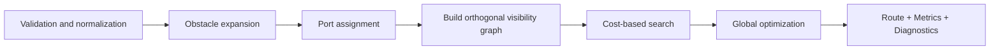

# Flow Graph

`@yiku/flow-graph` is an orthogonal routing package with no UI dependencies. Callers provide rectangular nodes, semantic edges, port constraints, and additional obstacles, and the router returns stable bend points, rounded SVG Paths, quality metrics, and degradation diagnostics.

## Input

```ts
interface FlowGraphInput {
  nodes: readonly GraphNode[];
  edges: readonly GraphEdge[];
  obstacles?: readonly GraphObstacle[];
}
```

Basic usage:

```ts
import { OrthogonalRouter } from "@yiku/flow-graph";

const router = new OrthogonalRouter();
const result = router.route({
  nodes: [
    { bounds: { x: 0, y: 20, width: 100, height: 44 }, id: "input" },
    { bounds: { x: 240, y: 20, width: 100, height: 44 }, id: "tool" },
  ],
  edges: [
    {
      id: "input-to-tool",
      source: { nodeId: "input" },
      target: { nodeId: "tool" },
    },
  ],
  obstacles: [
    {
      bounds: { x: 130, y: 0, width: 70, height: 50 },
      id: "reserved-panel",
    },
  ],
});
```

Node IDs, Edge IDs, and Obstacle IDs must be unique. Edge endpoints must reference existing Nodes. Rectangle dimensions, coordinates, Slots, and Route Bounds must be finite valid numbers.

## Ports

```ts
{
  source: {
    nodeId: "input",
    port: { mode: "fixed", side: "right", slot: 0.5 },
  },
  target: {
    nodeId: "tool",
    port: { mode: "preferred", side: "left" },
  },
}
```

Modes:

- `fixed`: Side and explicit Slot are hard constraints;
- `preferred`: prefer the specified Side/Slot, but adjust when there is no solution;
- Unconfigured: selected automatically based on the relative positions of nodes and overall graph quality.

The Slot range is `0..1`. Multiple edges on the same node are stably assigned different Slots; explicit fixed reuse keeps the configuration and generates a diagnostic.

`portStubLength` controls the shortest straight segment after a port leaves a node, independently of obstacle `clearance`.

## Routing Flow



Key behaviors:

1. Sort and normalize inputs so that array order does not affect results;
2. Expand Nodes and additional Obstacles by the Clearance;
3. Generate candidates for fixed, preferred, and automatic ports;
4. Search for polyline paths using the orthogonal visibility graph;
5. Evaluate collisions, overlaps, overly close parallels, crossings, length, bends, and port deviation;
6. Reduce global conflicts through a bounded number of optimization rounds;
7. When there is no zero-conflict solution, return a visible Fallback and diagnostics.

Crossings are a bounded cost rather than an absolute prohibition. To avoid extreme detours, the router may keep a small number of clearly oriented crossings.

## Output

```ts
interface RoutedGraphEdge {
  id: string;
  points: readonly GraphPoint[];
  path: string;
  sourcePort: ResolvedPort;
  targetPort: ResolvedPort;
  metrics: RouteMetrics;
  diagnostics: readonly RouteDiagnostic[];
  fallback: boolean;
  length: number;
}
```

The global `FlowGraphMetrics` aggregates:

- Path count;
- Collisions;
- Overlaps;
- Overly close parallels;
- Crossings;
- Length;
- Bends;
- Port deviation;
- Fallback count;
- Optimization rounds.

Callers should display Fallbacks or Warnings, rather than treating valid but imperfect routes as structural errors.

## Diagnostics

| Code | Meaning |
| --- | --- |
| `ROUTE_COLLISION_FALLBACK` | Fallback still has collisions |
| `ROUTE_CROSSING_REMAINS` | Crossings remain after optimization |
| `ROUTE_OPTIMIZATION_LIMIT` | Optimization round limit reached |
| `ROUTE_OVERLAP_REMAINS` | Shared segments remain |
| `ROUTE_PORT_REUSED_BY_CONSTRAINT` | Fixed constraints require port reuse |
| `ROUTE_PROXIMITY_REMAINS` | Parallel line spacing is still insufficient |

Diagnostics only describe routing quality. Structurally invalid input throws a `FlowGraphError`.

## Route Bounds

Edges can provide `routeBounds` to limit the search area. Bounds must contain the Source/Target and the fixed port exits. It is suitable for confining edges to a specific canvas area, but overly small Bounds increase Fallbacks.

## Segment Offset

`offsetOrthogonalRoute()` shifts specified segments by base segment number after routing:

```ts
import { offsetOrthogonalRoute } from "@yiku/flow-graph";

const points = offsetOrthogonalRoute(route.points, {
  2: 12,
  4: -8,
});
```

Segment numbers start at `1`. For horizontal segments, positive numbers go down; for vertical segments, positive numbers go right. The function preserves the start and end points, adding short orthogonal connecting segments when necessary.

Offsetting is an explicit presentation post-processing:

- It does not re-avoid obstacles;
- It does not update Router Metrics;
- Callers are responsible for checking the offset result;
- It should not be used to fix structurally invalid routes.

## SVG and Other Rendering

The Router returns a rounded SVG `path` directly, and you can also render yourself from `points`:

- SVG Polyline/Path;
- Canvas 2D;
- DOM Overlay;
- React;
- Static test snapshots.

The core package does not access the DOM, nor does it decide Stroke, Marker, Hover, animation, or hit areas.

## Determinism

The same normalized input and Router Options produce the same result. Determinism depends on:

- Sorting nodes and edges by ID;
- Stable port candidate ordering;
- Stable search tie-breakers;
- Bounded optimization rounds;
- No use of random numbers or measured timing.

This enables path Snapshots, caching, and regression comparison.

## Edge Cases

- An empty graph returns an empty Route and zero Metrics.
- Identical Source and Target produce a self-loop outside the node.
- Adjacent facing ports can connect directly.
- Overlapping a Node with an additional Obstacle may enter Fallback.
- When a fixed port is unreachable, the Side is not changed unilaterally.
- When a valid input has no perfect solution, return a Fallback rather than throwing a structural error.
- Requests exceeding the configured Node, Edge, or coordinate limits are rejected to avoid resource runaway.

## Options

`OrthogonalRouterOptions` can set:

- `clearance`
- `portStubLength`
- `parallelGap`
- `roundingRadius`
- Bend/Crossing/Overlap/Proximity/Port Deviation Penalty
- Maximum Node, Edge, coordinate, and optimization round counts

Custom values must be finite, non-negative, and within the corresponding limits.

## Public Entry Points

- `OrthogonalRouter`
- `offsetOrthogonalRoute`
- `toRoundedSvgPath`
- Geometry helpers
- Graph, Port, Route, Metrics, and Diagnostic types
- `FlowGraphError`

## Verification

```bash
corepack pnpm --filter @yiku/flow-graph build
corepack pnpm --filter @yiku/flow-graph test
```

For Observatory integration, see [Observability](../architecture/observability.md).
