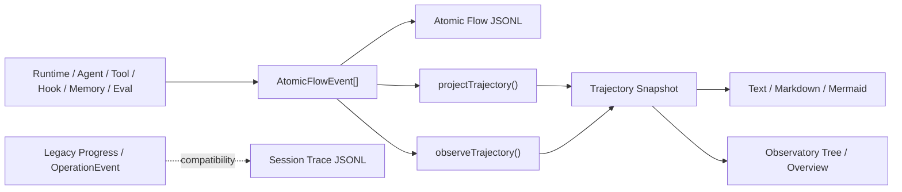

# Trajectory

`@yiku/trajectory` projects Atomic Flow into hierarchical execution trajectories, and provides text, Markdown, Mermaid, and a compatible JSONL Trace. A standard Agent Run uses Atomic Flow as its single source of truth.

## Positioning and Data Sources



The standard path does not separately record a Trajectory state. Atomic Flow JSONL stores the facts, and the Trajectory is rebuilt when read or subscribed to; therefore Topology, Replay, and Trajectory can share the same `runId` and `sequence` prefix.

## Data Model

```ts
interface Trajectory {
  id: string;
  startedAt: string;
  endedAt?: string;
  steps: readonly TrajectoryStep[];
}

interface TrajectoryStep {
  atomKey?: string;
  id: string;
  kind: AtomicKind | OperationKind;
  name: string;
  parentId?: string;
  iteration?: number;
  startedAt: string;
  endedAt?: string;
  status: "running" | "completed" | "failed";
}
```

Step IDs correspond to Atomic Instance IDs. Parent, Iteration, status, and time come directly from the event prefix.

Example projection:

```json
{
  "id": "run-42",
  "startedAt": "2026-08-20T10:00:00.000Z",
  "endedAt": "2026-08-20T10:00:03.000Z",
  "steps": [
    {
      "atomKey": "run",
      "id": "run-instance",
      "kind": "input",
      "name": "Run",
      "startedAt": "2026-08-20T10:00:00.000Z",
      "endedAt": "2026-08-20T10:00:03.000Z",
      "status": "completed"
    },
    {
      "atomKey": "tool.call",
      "id": "tool-17",
      "parentId": "run-instance",
      "iteration": 2,
      "kind": "tool",
      "name": "Tool Call",
      "startedAt": "2026-08-20T10:00:01.000Z",
      "endedAt": "2026-08-20T10:00:02.000Z",
      "status": "completed",
      "output": { "summary": "Read 120 lines" }
    }
  ]
}
```

## Static Projection

```ts
import {
  projectTrajectory,
  renderTrajectoryText,
} from "@yiku/trajectory";

const trajectory = projectTrajectory(events);
console.log(renderTrajectoryText(trajectory));
```

Projection rules:

- Sort by Sequence;
- All Events must belong to the same Run;
- `throughSequence` can project any Replay prefix;
- Internal Trace/Trajectory Receipts do not enter the user trajectory;
- An empty Event array must be given an explicit `runId`;
- The same event prefix produces the same trajectory.

A mixed Run fails directly, rather than silently losing events through filtering.

### Generation Algorithm

The generation steps of `projectTrajectory()` are deterministic:

1. Copy the input and sort it in ascending `sequence` order;
2. Take `runId` from the first event; for empty input, require the caller to provide it explicitly;
3. Reject event sets containing any other `runId`;
4. Apply `throughSequence` and filter out Trace/Trajectory receipts with `internal=true`;
5. Fold keyed by `instance.id`: the first event creates the Step, and subsequent events update the same Step in place;
6. `start`, `scheduled`, and `delta` map to `running`; `end`/`skipped` map to `completed`; `error` maps to `failed`;
7. Terminal states write `endedAt`, error summaries write `error`, and the latest bounded Payload writes `output`;
8. The terminal time of the Atom with Key `run` becomes the Trajectory's `endedAt`.

Step order is the order in which each Instance first appears in the sorted event stream. `delta` does not add a Step, nor does it change its order. The projection does not guess hierarchy from Edges; it uses only `instance.parentId`. Edges remain in Atomic Flow for flow relationships.

## Live Projection

```ts
import { observeTrajectory } from "@yiku/trajectory";

const projection = observeTrajectory(flow);
const unsubscribe = projection.subscribe((trajectory) => {
  console.log(trajectory.steps.length);
});

const snapshot = projection.snapshot();

unsubscribe();
projection.close();
```

`AtomicTrajectoryProjection` subscribes to the Flow, but Subscriber errors do not affect the originating run. After the Projection is closed, the Flow subscription and listeners are cleaned up.

Live update mechanism:

- On creation, first copy `flow.snapshot().events` to avoid missing events that occurred before subscription;
- Subsequent events are appended in Flow dispatch order;
- After each append, regenerate an unshared-state Snapshot from the current event prefix;
- Listeners receive new Snapshots one by one, and a single Listener throwing is isolated;
- `snapshot({ throughSequence })` can view a historical prefix on a live Flow;
- `close()` is idempotent; after closing, no more events are received and no new Listeners are accepted.

This implementation prioritizes consistency with the static projection. Trajectory is not a command channel; modifying a Snapshot does not reverse-modify the Agent, Atomic Flow, or Session state.

## Renderer

```ts
import {
  renderTrajectoryMarkdown,
  renderTrajectoryMermaid,
  renderTrajectoryText,
} from "@yiku/trajectory";
```

- Text: terminals and logs;
- Markdown: Session export and auditing;
- Mermaid: static hierarchy diagrams;
- `includeRawValues`: when explicitly allowed, shows compatible Operation inputs and outputs.

Atomic Payloads contain only summaries by default, so Renderers should not rely on complete Tool inputs/outputs.

## Browser Entry

The browser imports the projection capability from the following entry:

```ts
import { projectTrajectory } from "@yiku/trajectory/browser";
```

This entry does not include the Node filesystem Trace, preventing the browser bundle from pulling in `node:fs`.

## Trace

`Trace<TEvent>` is a compatible append-only JSONL recorder:

```ts
import { Trace } from "@yiku/trajectory";

const trace = new Trace("/absolute/path/to/session.jsonl");
trace.record(event);
```

Each line contains Step, Recorded At, Event, and an optional Result. Trace uses synchronous appends and holds no closable resources; write failures should not block the Agent Session, and reading a nonexistent or corrupted compatible Trace returns an empty list.

Session Trace and Atomic Flow JSONL serve different purposes:

| Data | Fact Semantics |
| --- | --- |
| Atomic Flow JSONL | Run-level atomic execution facts; can be Folded and Replayed |
| Session Trace | Compatibility audit log of host Progress Events |
| Trajectory | Hierarchical view derived from Atomic Flow |

## Storage Structure

Yiku CLI's related data lives by default under the same Workspace Storage:

```text
~/.yiku/workspaces/<workspace>/
├── session/
│   ├── <session-id>.jsonl                 # 兼容 Progress Trace
│   └── <session-id>.events.jsonl          # AgentMessageEnvelope
└── logs/
    ├── atomic-runs/<run-id-sha256>/flow.jsonl  # 权威 Atomic Flow
    └── runs/<run-storage-key>/flow.jsonl       # Studio/Observatory 接收的 Flow 副本
```

Trajectory Snapshots are not persisted separately by default. When long-term preservation or cross-process reconstruction is needed, save the Atomic Flow JSONL and then call `projectTrajectory()`. Each line of the compatible `Trace<TEvent>` has the structure:

```json
{
  "step": 17,
  "recordedAt": "2026-08-20T10:00:02.000Z",
  "event": { "type": "tool_output", "toolName": "readTool" },
  "result": "Read 120 lines"
}
```

On reopening, `Trace` reads the last valid Step and continues numbering; writes use synchronous Append. It is a best-effort compatibility audit: write errors are swallowed, and reads return an empty array when the file does not exist or any JSON line is corrupted. The Atomic Flow Reader, by contrast, validates strictly and reports `ATOMIC_FLOW_JSONL_INVALID`; when reliable Replay is needed, Atomic Flow must be used.

## Compatibility Entry

`TrajectoryRecorder` can directly consume legacy `OperationEvent`s. `AtomicTrajectorySink` can generate `trajectory.project` Receipts for legacy hosts.

A standard Orchestrator does not mount this Sink; it generates Trajectory directly from Atomic Flow in its results, and Agent Observatory also projects from the same Event prefix.

## Hierarchy and Errors

- The projection preserves producer-provided `parentId`s and does not fabricate or rewrite causality;
- Observatory builds a tree only when the Parent exists and the chain is acyclic; a missing Parent, self-reference, or cycle is flattened to root-level rows;
- Renderers consume the flat Step array; Mermaid draws links according to existing `parentId`s, and callers should validate external input first;
- `error` terminal states retain safe error summaries;
- Delta updates the current Step and does not create a new Step;
- `scheduled` / `skipped` are mainly used for Flow Replay and do not generate fictitious execution durations.

## Use Cases

| Scenario | Recommended Entry | Reason |
| --- | --- | --- |
| Post-run diagnostics and export | `projectTrajectory(events)` | Deterministic results, easy to test |
| In-run UI | `observeTrajectory(flow)` | Automatically follows the current event prefix |
| Replay to a specific moment | `throughSequence` | Uses the same sequence boundary as Topology |
| Terminal or log summaries | `renderTrajectoryText()` | Compact, no browser dependency |
| Audit documents | `renderTrajectoryMarkdown()` | Readable and suitable for export |
| Static structure descriptions | `renderTrajectoryMermaid()` | Shows Parent/Child relationships |
| Legacy host Progress auditing | `Trace` | Compatible with existing JSONL; not a source of truth |

When troubleshooting, first locate the `id`/`atomKey` of the failed Step, then return to the Atomic Events with the same `runId` to inspect the Sequence, Edge, and bounded Payload. Performance analysis can compute durations from `startedAt`/`endedAt`, but wall-clock time should not be used for causal ordering across Agents.

## Main Exports

- `projectTrajectory`
- `observeTrajectory`
- `AtomicTrajectoryProjection`
- `renderTrajectoryText`
- `renderTrajectoryMarkdown`
- `renderTrajectoryMermaid`
- `Trace` / `readTraceEntries`
- `TrajectoryRecorder`
- `AtomicTrajectorySink`
- `TRAJECTORY_ATOMS`

## Verification

```bash
corepack pnpm --filter @yiku/trajectory build
corepack pnpm --filter @yiku/trajectory test
```

For source events, see [Atomic Flow](atomic-flow.md); for built-in nodes, see the [Atom Catalog](atom-catalog.md).
