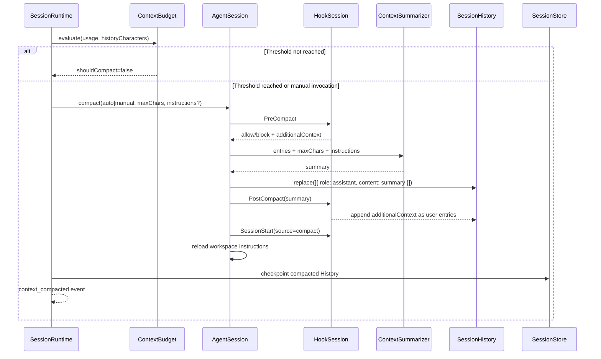

# Context Compact

Yiku's Context Compact compresses overly long conversation history into a single summary that can continue execution. It solves the model context budget problem without deleting the Session's tasks, Checkpoints, Working Memory, Agent Profile, Atomic Flow, or disk logs.

## Component Responsibilities

| Component | Responsibility | Not Responsible For |
| --- | --- | --- |
| `ContextBudget` | Determines whether to auto-compact and computes the summary character limit | Calling the model or modifying history |
| `ContextCompactor` | Runs Hooks, calls the Summarizer, validates the summary, and replaces History | Deciding whether the Stage continues |
| `OpenAIContextSummarizer` | Uses a tool-less, single-Turn Code Agent to generate a plain-text summary | Persisting Session State |
| `AgentSession` | Exposes `compact()`, reloads Session/Workspace instructions after compaction | Automatic trigger timing |
| `SessionRuntime` | Automatically decides at a resumable Stage boundary, syncs History, and emits events | Summary content generation |
| CLI `/compact` | Initiates manual compaction and displays progress | Changing automatic thresholds |

## Trigger Methods

### Automatic Trigger

The persistent `SessionRuntime` only calls `maybeCompact()` when a Stage has ended and the execution strategy decides to continue. Compaction is never inserted while the model or tools are still executing, and it never interrupts the current Stage.

Decision priority:

1. When both `contextWindow` and the accumulated `peakInputTokens` for this turn exist, use the token ratio;
2. When either token metric is missing, use the History character count and the `32,768` character fallback limit;
3. Compaction only occurs when `compactAtContextRatio` is reached; the summary budget is computed by `compactToContextRatio`;
4. The token path converts to `maxSummaryChars` at 4 characters per token;
5. After success, the accumulated `peakInputTokens` is cleared and re-measured from the next Stage.

Default configuration:

```yaml
runtime:
  compactAtContextRatio: 0.7
  compactToContextRatio: 0.25
```

Calculation rules:

```text
Token 路径：
shouldCompact = peakInputTokens / contextWindow >= compactAtContextRatio
maxSummaryChars = floor(contextWindow * compactToContextRatio * 4)

字符回退：
shouldCompact = historyCharacters >= 32768 * compactAtContextRatio
maxSummaryChars = floor(32768 * compactToContextRatio)
```

`compactToContextRatio` must be smaller than `compactAtContextRatio`, and both must lie strictly between `0` and `1`.

### Manual Trigger

```text
/compact
/compact preserve decisions, open tasks, file paths, commands, and errors
```

Arguments are passed to the Summarizer as `customInstructions`. When no summary limit is explicitly passed, the Hook-configured `compactionMaxChars` takes precedence; otherwise the default is `8,000` characters. Manual compaction does not depend on thresholds.

## Full Flow



The automatic path writes the compacted History into Session State immediately. Manual `/compact` first modifies the current `AgentSession`'s in-memory History; it is persisted during the next normal Session Checkpoint, so `/compact` should not be treated as a standalone persistence command. The original Transcript, Progress/Event JSONL, and Atomic Flow are not rewritten.

## Summary Contract

Input:

```json
{
  "entries": [
    { "role": "user", "content": "Implement the feature" },
    { "role": "assistant", "content": "Inspected runtime.ts" }
  ],
  "maxChars": 8000,
  "customInstructions": "Preserve decisions and unresolved tasks"
}
```

Output:

```json
"Goal: implement the feature. Completed: inspected runtime.ts. Remaining: ..."
```

`ContextSummarizer.summarize()` returns a string. The summary must be non-empty plain text and, after trimming leading and trailing whitespace, must not exceed `maxChars`. The fixed requirements of the default OpenAI Summarizer are to preserve decisions, constraints, completed work, unfinished tasks, file paths, commands, and errors; it must not invent facts and cannot call tools.

## History and Trust Boundary

After a successful compaction, the History order is:

1. A single `assistant` summary;
2. Additional Context returned by `PostCompact`, appended as `user` entries;
3. `SessionStart(source=compact)` and the re-read Workspace Instructions enter a separate source-tagged Context Segment.

The summary is model-generated content and is still wrapped as `untrusted` Conversation History in subsequent Prompts. Compaction does not elevate permissions, expand the Capability Scope, or turn Hook or Workspace content into System Instructions.

## Events and Observability

A successful automatic compaction emits:

```json
{
  "type": "context_compacted",
  "beforeEntries": 42,
  "afterEntries": 1
}
```

This Progress Event is projected as the `context.compact` Atomic Atom. After the CLI receives the event, it resets the current context usage, and the status bar then re-accumulates based on the new `usage_updated` event. The event only records the number of entries and does not expose the summary body.

## Atomicity and Failure Semantics

- `block` or `stop` from `PreCompact` terminates before the Summarizer is called, and History remains unchanged;
- When the Summarizer throws, returns an empty string, or exceeds the character limit, History remains unchanged;
- The AbortSignal is passed to the Summarizer;
- History is only `replace()`d once, after the summary is complete and passes validation;
- `PostCompact` runs after the History replacement, and its failure does not roll back the already-generated summary;
- When no Summarizer is configured, both manual and automatic compaction fail explicitly;
- Compaction only reduces the Conversation History sent to the model; it does not delete audit records or other Session state.

## Validation

```bash
corepack pnpm --filter @yiku/agent-orchestrator test
corepack pnpm --filter @yiku/cli test
```

Configuration fields are described in [Configuration and Storage](../atoms/configuration-and-storage.md), the Session lifecycle in [Runtime and Orchestration](../architecture/runtime-and-orchestration.md), and the Hook contract in [Hooks](hooks.md).
