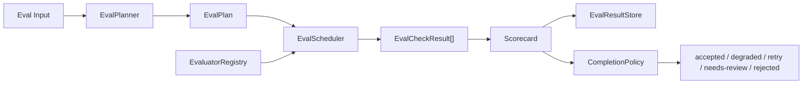
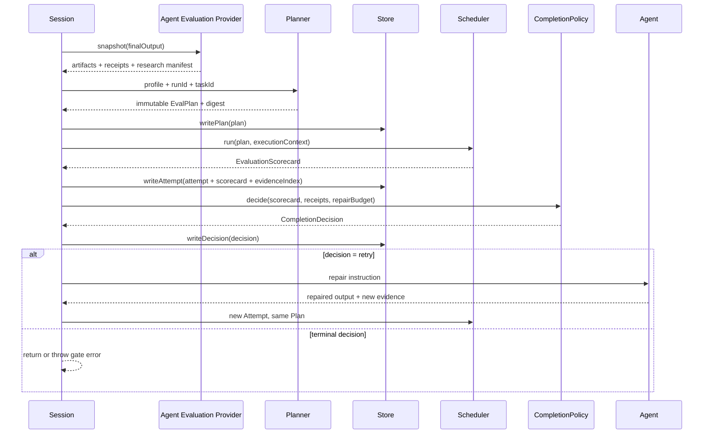

# Evals

`@yiku/evals` provides explainable, persistable quality assessment for completed Agent Runs. It consumes the final output, Artifacts, Operation Receipts, Research Manifest, and Atomic Flow Snapshot; it does not execute Agents and does not independently decide the Session's terminal state.

## Two Entry Points

| Entry Point | Purpose | Result | Currently Used By |
| --- | --- | --- | --- |
| `EvalRunner` | Compatible sequential Evaluator list | `EvalScorecard` | Low-level/legacy hosts |
| `EvalPlanner` + `EvalScheduler` | Profile, DAG, evidence, immutable records, and concurrency limits | `EvaluationScorecard` | CLI persistent Session |
| `EvaluationCoordinator` | Combines Plan, Attempt, Store, Completion Policy, and Repair | `EvaluationOutcome` | Orchestrator |

New hosts that need quality gates and auditability should use the industrial pipeline. `EvalRunner` is still supported but does not provide Plan, Attempt, Evidence Index, Baseline, or automatic repair semantics.

## Evaluation Pipeline





## Core Objects

### Profile

`EvalProfile` defines:

- Mode: `observe` or `enforce`;
- Check definitions, weights, and dependencies;
- Quality thresholds;
- Maximum concurrency, input size, timeout, and repair count;
- Required/Optional;
- Severity and evidence requirements.

### Plan

`EvalPlanner` resolves the Profile and Registry capabilities into an immutable Plan. It validates:

- Duplicate IDs;
- Unknown Evaluators;
- Missing dependencies and dependency cycles;
- Check count and resource limits;
- Required Capability;
- Deterministic Digest.

Check sources are merged in the following order: Managed Profile, Project Profile, User Acceptance, Agent Factory, Agent Suggestion. An existing ID can only reappear with an exactly identical definition; lower-priority sources cannot redefine higher-priority Checks. The Managed Profile also determines the Mode, Threshold, Dimension Weight, and Limits. Once a Plan is created it is frozen, and a Repair continues to use the same Plan Digest.

### Scheduler

`EvalScheduler` runs Checks according to a dependency DAG:

- At most 4 concurrent Checks per Run by default;
- At most 8 concurrent Runs globally by default;
- At most 32 Checks per Run;
- AbortSignal propagates to queuing, Evaluators, Verification Commands, and Repair; a Store Commit completes its own atomic write and does not accept the same cancellation signal;
- An error thrown by a single Evaluator is converted to a structured `error` result;
- When a dependency fails, downstream Checks are `not-run`.

The Scheduler only starts Ready Checks whose dependencies have all `passed`, and maintains a stable selection order by Plan `ordinal`. Checks in the same `concurrencyGroup` are serial by default, and the host can inject a higher Group Limit. An Attempt Timeout turns Checks that have not yet run into `not-run` with `EVAL_TIMEOUT`; an external Abort terminates the entire evaluation and is not disguised as a Scorecard.

## Execution Protocol

The core structure of the Evaluator Input:

```json
{
  "runId": "run-42",
  "taskId": "session-9",
  "attemptId": "attempt-1",
  "finalOutput": "Implemented and verified.",
  "finalOutputDigest": "sha256:...",
  "flowRef": "atomic:run-42",
  "taskSnapshotRef": "session:session-9",
  "artifacts": [],
  "operationReceipts": [],
  "runtimeMetrics": {
    "durationMs": 1234,
    "peakRssBytes": 67108864
  }
}
```

A single Check Output:

```json
{
  "version": 1,
  "id": "flow-integrity",
  "evaluator": "flow-integrity-v2",
  "label": "Flow Integrity",
  "dimension": "safety-reliability",
  "severity": "blocker",
  "required": true,
  "status": "passed",
  "passed": true,
  "score": 1,
  "retryable": false,
  "evidenceRefs": ["atomic:run-42"],
  "summary": "Flow is valid.",
  "durationMs": 3
}
```

An Evaluator must return an ID, Evaluator, Dimension, Severity, and Required consistent with the Planned Check. `status=error` must carry a stable `errorCode`, and `passed` must be consistent with `status=passed`; invalid results are handled as protocol errors and cannot enter a successful Scorecard.

## Scoring

The Scorecard aggregates by Dimension and Weight. The default dimensions include Correctness, Safety/Reliability, Performance, and Resource Efficiency.

Rules:

- `error`, `not-run`, and missing Scores count as 0 in the denominator;
- Blocker, Secret, Boundary Violation, and Artifact Drift cannot be offset by average scores;
- Required Check failures affect the completion decision;
- The Digest does not include non-deterministic noise such as runtime duration;
- The same Plan, Input, and results produce the same Scorecard Digest.

Each Dimension first computes the Check Weight-weighted score; a Dimension with no Checks is recorded as `1`. Then `overallScore` is computed according to the Profile's `dimensionWeights`. `averageScore` is the simple average of all Checks and is used for display only. The Grade mapping is: `S >= 0.95`, `A >= 0.90`, `B >= 0.80`, `C >= 0.70`, and the rest are `D`.

`qualityPassed` simultaneously requires: no non-passing Blocker, no `partial`/`unknown` Operation Receipt, all Required Checks passing, and the overall score reaching the Threshold. `passed` is consistent with `qualityPassed`.

## Default Evaluators

General Evaluators:

- `FlowIntegrityEvaluator`
- `FinalOutputEvaluator`
- `MemorySafetyEvaluator`
- `PerformanceBudgetEvaluator`
- `ResourceBudgetEvaluator`

An optional `JudgeProvider` handles content requiring model judgment. Deterministic checks take precedence; the Judge cannot replace Artifact, Evidence, or protocol integrity.

## Code Eval

`@yiku/agent-code` provides:

- File Before/After Snapshots;
- Artifact Digest and Scope;
- Symlink and boundary evidence;
- Structured Verification Commands;
- Change scope and Artifact consistency checks.

Verification Command example:

```yaml
evals:
  profiles:
    code-ci:
      type: code
      qualityThreshold: 0.85
      requireChanges: true
      commands:
        - id: lint
          command: corepack
          args: [pnpm, lint]
          network: deny
          writePolicy: isolated
          timeoutMs: 300000
```

`isolated` commands run in a temporary workspace; `read-only` commands cannot modify the Workspace.

## Research Eval

`@yiku/agent-research` provides Claim/Citation, conflict, source diversity, freshness, authority, and report structure checks:

```yaml
evals:
  profiles:
    research-strict:
      type: research
      freshnessDays: 90
      minimumIndependentDomains: 3
      qualityThreshold: 0.85
```

Missing Evidence, unknown Citations, or Unsupported Claims cannot be erased through an Optional Judge.

## Runtime Configuration

```yaml
evals:
  enabled: true
  mode: enforce
  maxConcurrentRuns: 8
  maxRepairAttempts: 1
  timeoutMs: 600000
  profile: code-default
  profiles: {}
```

Default Profiles:

- `code-default`
- `research-default`

When not explicitly selected, one is chosen based on the Agent Type. Unknown fields, invalid Profile references, and out-of-bounds limits fail before the Session starts.

## Completion Policy

The Orchestrator's `EvaluationCoordinator` maps a Scorecard to:

| Decision | Meaning |
| --- | --- |
| `accepted` | Meets quality and hard gates |
| `degraded` | Completion is allowed, but infrastructure or optional capabilities are degraded |
| `retry` | Can be re-evaluated after repair within budget |
| `needs-review` | Insufficient evidence, unknown side effects, or infrastructure state requires human judgment |
| `rejected` | Hard gate or quality requirement failure |

The CLI defaults to `enforce`. A single repair keeps the same Task, creates a new Attempt, and feeds the failed Check and Repair Instruction back to the Agent. There is no infinite loop once the repair budget is exceeded.

Decision order:

1. `partial` or `unknown` Operation Receipt -> `needs-review`;
2. Blocker failure -> `retry` when there are repairable items and budget, otherwise `rejected`;
3. Required Check is `error`/`not-run` -> `needs-review`;
4. Required Check failure or insufficient overall score -> `retry` or `rejected`;
5. Only Optional Checks did not pass -> `degraded`;
6. The rest -> `accepted`.

Both `observe` and `enforce` generate complete records. `observe` does not throw a Gate Error for non-accepted decisions and does not trigger automatic Repair; `enforce` throws `EvaluationGateError` for `needs-review`/`rejected`. Both `accepted` and `degraded` allow the Session to complete, but only `accepted` automatically promotes the current turn's long-term Memory.

## Store

`FileEvalResultStore` persists:

- Plan;
- Attempt;
- Scorecard;
- Evidence Index;
- Completion Decision;
- Baseline.

Default path:

```text
~/.yiku/workspaces/<workspace>/evals/
```

A single top-level Atomic Run may contain multiple internal Turns or Stages. The first evaluation reuses the Atomic Run ID; subsequent evaluations derive independent Eval Run IDs using the `.eval-<sequence-number>` suffix and continue to associate with the same Atomic Flow via `flowRef`. Therefore, each Eval Plan remains immutable, and multi-stage continuation runs do not overwrite the evaluation records of previous stages.

The Store uses private permissions, cross-process Locks, temporary files, File Sync, atomic Rename, and directory Sync. Retries with the same Digest are idempotent; writing a different Digest to the same immutable ID returns a conflict.

Directory structure:

```text
~/.yiku/workspaces/<workspace>/evals/
├── runs/
│   └── <sha256-run-id>/
│       ├── plan.json
│       └── attempts/
│           └── <sha256-attempt-id>/
│               ├── attempt.json
│               ├── scorecard.json
│               ├── evidence-index.json
│               └── decision.json
├── baselines/
│   └── <sha256-suite-id>/<sha256-baseline-version>.json
├── feedback/
└── locks/
```

`writeAttempt()` first writes the Attempt, Scorecard, and Evidence Index completely into a temporary directory in the same directory, then Renames after Sync, to avoid partial visibility. A Decision is written only when the target Attempt already exists and the Run/Task relationship is consistent. The Reader re-validates the Version, Digest, Count, and object relationships; corrupted data returns `EVAL_STORE_CORRUPT` and is not silently ignored. Directory names use the SHA-256 of the original IDs, and semantic IDs are preserved within the JSON records.

## Baseline

`createEvalBaseline()` generates a Baseline from approved results, and `compareEvalBaseline()` compares Checks, Dimensions, overall scores, and environment changes. Baselines should be isolated by Suite, model, Prompt/Skill version, and runtime environment; development machine results must not be used directly as Linux CI thresholds.

## CLI Output

The interactive timeline displays:

- Grade and overall score;
- passed/failed/error/not-run counts;
- Completion Decision;
- Failed Checks and evidence summaries;
- Repair Attempt.

Non-interactive mode:

```bash
yiku --output-format json "执行任务"
yiku --output-format ndjson "执行任务"
```

The exit code for `needs-review` is `6`, and for `rejected` it is `8`.

## Atomic Flow and Observability

The industrial pipeline writes the following main Atoms:

```text
eval.trigger -> eval.attempt -> eval.<check> -> eval.scorecard
             -> eval.repair? -> eval.decision -> eval.gate
```

The Atom Payload retains only the Check ID, status, score, counts, Attempt ID, and security summary; the complete Plan, Evidence, Scorecard, and Decision reside in the Eval Store. Exceptions from the Logger and Metrics Adapter are isolated and cannot change the evaluation results. Built-in Counters/Histograms include Run, Check, Repair, Error, Attempt Duration, Check Duration, Scheduler Queue, Store Operation, RSS, and Persisted Bytes.

## API Example

```ts
import {
  createDefaultEvalProfile,
  EvalPlanner,
  EvalScheduler,
  EvaluatorRegistry,
} from "@yiku/evals";

const registry = new EvaluatorRegistry(evaluators);
const profile = createDefaultEvalProfile({ mode: "enforce" });
const plan = new EvalPlanner({ registry }).createPlan({
  profile,
  runId,
  taskId,
});
const scorecard = await new EvalScheduler({ registry }).run(plan, context);
```

## Performance Gates

```bash
corepack pnpm --filter @yiku/evals build
corepack pnpm --filter @yiku/evals performance
```

After warm-up, the script measures 32-Check scheduling, 8-Run concurrency, nearly 10 MiB of input, File Store commits, and RSS. The default gates are:

- Scheduler P95 `< 100 ms`;
- Store Commit P95 `< 50 ms`;
- RSS increment `< 256 MiB`.

The script only measures framework overhead and does not include Provider, network, or project command time.

## Failure Semantics

- Invalid configuration and Plans throw `EvaluationError` directly;
- Evaluator runtime errors become failed Checks;
- Missing Required Capability leads to `needs-review` or startup failure;
- Store conflicts, corruption, and permission errors are not disguised as passing;
- Aborting stops queued and running Checks;
- Observer or Studio failures only affect observability and do not change the Scorecard;
- Any missing result cannot raise the score.

## Main Exports

- `EvalPlanner`
- `EvalScheduler`
- `EvaluatorRegistry`
- `EvalRunner`
- `FileEvalResultStore`
- `createDefaultEvalProfile`
- `createEvaluationScorecard`
- `createEvalBaseline` / `compareEvalBaseline`
- Default Evaluators, record validators, Canonical Digest, and types

## Validation

```bash
corepack pnpm --filter @yiku/evals test
corepack pnpm --filter @yiku/agent-orchestrator test
```

Atom definitions are described in the [Atom Catalog](../atoms/atom-catalog.md).
