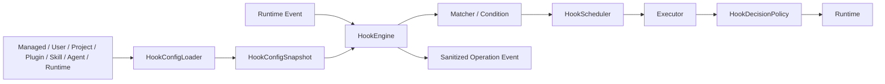

# Hooks

`@yiku/hooks` is Yiku's lifecycle policy enforcement layer. It is responsible for the event contract, configuration compilation, matching, execution, decisions, explicit trust, and security limits, and does not depend on the Agent SDK, Orchestrator, CLI, or Atomic Flow.

## Data Flow



## Events

The current protocol contains 30 events:

```text
SessionStart
Setup
InstructionsLoaded
UserPromptSubmit
UserPromptExpansion
MessageDisplay
PreToolUse
PermissionRequest
PostToolUse
PostToolUseFailure
PostToolBatch
PermissionDenied
Notification
SubagentStart
SubagentStop
TaskCreated
TaskCompleted
Stop
StopFailure
TeammateIdle
ConfigChange
CwdChanged
FileChanged
WorktreeCreate
WorktreeRemove
PreCompact
PostCompact
SessionEnd
Elicitation
ElicitationResult
```

The Yiku Runtime integrates 28 of them. `WorktreeCreate` and `WorktreeRemove` currently return an explicit `HOOK_CAPABILITY_UNAVAILABLE` and are not silently skipped.

## Configuration Sources

Hook sources are compiled with a stable priority, but different sources do not override each other; all matching Handlers participate in the decision:

- Managed Settings;
- `~/.yiku/config.yaml`;
- `<workspace>/config.yaml`;
- Plugin `hooks/hooks.json`;
- Skill/Agent Frontmatter;
- Runtime Callback.

Yiku does not read other products' user configuration files. Compatibility refers to the event and Handler protocol; it does not imply shared configuration directories.

Configuration example:

```yaml
hooks:
  PreToolUse:
    - matcher: Bash|Edit
      hooks:
        - type: command
          command: node .yiku/hooks/check-policy.mjs
          timeout: 15
          statusMessage: Checking repository policy
  Notification:
    - matcher: permission_prompt
      hooks:
        - type: http
          url: https://hooks.example.com/events
          headers:
            Authorization: Bearer $HOOK_TOKEN
          allowedEnvVars: [HOOK_TOKEN]
```

`HookConfigLoader` generates an immutable Snapshot. The Reloader only replaces the current Snapshot after a complete new configuration compiles successfully, avoiding half-updated state.

## Matching

The Matcher matches Tools, notification types, Session sources, or other capabilities based on event-specific fields. Conditions only read permitted structured fields and do not execute arbitrary JavaScript. Configuration order is stable, and the Scheduler is responsible for serial, parallel, and one-time semantics.

## Executor

| Type | Execution Method | Key Limits |
| --- | --- | --- |
| `callback` | Host function | Deadline, AbortSignal |
| `command` | Subprocess stdin/stdout | Process tree, environment, bytes, and exit code |
| `http` | HTTPS Transport | DNS, SSRF, Redirect, Header Env |
| `prompt` | `HookModelRunner` | Tokens, structured output, timeout |
| `agent` | `HookAgentRunner` | Turns, tools, tokens, recursion depth |
| `mcp` | `HookMcpInvoker` | Target allowlist, connection state, reentrancy |

All external execution has resource limits and cancellation propagation.

## Command Protocol

The Command reads an event JSON from stdin, after which stdin is closed. stdout can be empty, plain text, or compatible JSON:

```js
let input = "";

process.stdin.setEncoding("utf8");
process.stdin.on("data", (chunk) => {
  input += chunk;
});
process.stdin.on("end", () => {
  const event = JSON.parse(input);
  if (event.hook_event_name === "PreToolUse" && event.tool_name === "Bash") {
    process.stdout.write(
      JSON.stringify({
        hookSpecificOutput: {
          hookEventName: "PreToolUse",
          permissionDecision: "deny",
          permissionDecisionReason: "Command violates repository policy",
        },
      }),
    );
  }
});
```

Exit codes:

- `0`: success;
- `2`: mapped to block, feedback, or ignore according to Event Capability;
- Others: generate `HOOK_EXECUTION_FAILED`.

stdout must still pass the event-specific Schema; an exit code cannot make invalid output take effect.

## Decision

Handlers can produce:

- `allow`
- `block`
- `defer`
- `no-op`
- `stop`

as well as `allow | ask | deny` permission recommendations. `HookDecisionPolicy` merges multiple results, rejecting conflicts or illegal escalation. A Hook's `allow` cannot override a `deny` from the Runtime, Workspace, or Managed Policy.

## Trust

External side-effect Handlers from Project, Local, Skill/Agent, and User sources require explicit trust by default. The Trust Key contains:

- Source;
- Hook and Handler Hash;
- Executor type;
- Command, Origin, or MCP Target;
- Environment variables and capability summary.

After a configuration change, the Hash changes and old trust no longer takes effect. CLI management entry points:

```text
/hooks list
/hooks inspect <hook-id>
/hooks trust <hook-id>
/hooks revoke <hook-id>
```

Trust only approves the configured Handler; it does not constitute approval of the specific command the Agent is currently issuing.

## HTTP and Network Security

- HTTPS only;
- URLs must not embed credentials;
- Private, loopback, and restricted addresses are rejected after DNS resolution;
- Each Redirect hop is re-validated;
- Headers can only reference explicit `allowedEnvVars`;
- Response bodies have a byte limit;
- MCP Targets must pass the Server/Tool allowlist.

## Audit and Redaction

`HookEvents` emits `load`, `trust`, `dispatch`, and `execute` operation events. Audit Observer errors do not recursively cause Hook failures. Records contain only the Hook ID, Source, Executor, status, duration, counts, and a security summary; Secrets, the complete environment, and untrusted large outputs pass through the Redactor.

## API Example

```ts
import {
  CallbackHookExecutor,
  HookConfigCompiler,
  HookEngine,
  HookExecutorRegistry,
  HookSession,
  hookSource,
} from "@yiku/hooks";

const snapshot = new HookConfigCompiler().compile([
  {
    source: hookSource("runtime"),
    value: {
      hooks: {
        UserPromptSubmit: [
          {
            hooks: [
              {
                callback: () => ({ additionalContext: "Use project policy." }),
                name: "project-policy",
                type: "callback",
              },
            ],
          },
        ],
      },
    },
  },
]).snapshot;
const engine = new HookEngine({
  executors: new HookExecutorRegistry([new CallbackHookExecutor()]),
  snapshot,
});
const session = new HookSession({ engine });

await session.dispatch({
  cwd: process.cwd(),
  hook_event_name: "SessionStart",
  permission_mode: "default",
  session_id: "session-1",
  source: "startup",
  transcript_path: "/tmp/session-1.jsonl",
});
```

For specific constructor parameters, refer to the root export types of `@yiku/hooks`.

## Errors

The stable error categories include Config, Matcher, Protocol, Execution, Timeout, Trust, Security, Capability, and Decision Conflict. Errors preserve security context and do not leak Secrets or complete untrusted output.

## Validation

```bash
corepack pnpm --filter @yiku/hooks build
corepack pnpm --filter @yiku/hooks test
corepack pnpm --filter @yiku/agent-orchestrator test
```

Engineering gates are described in [Engineering](../architecture/engineering.md).
