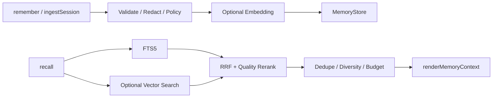
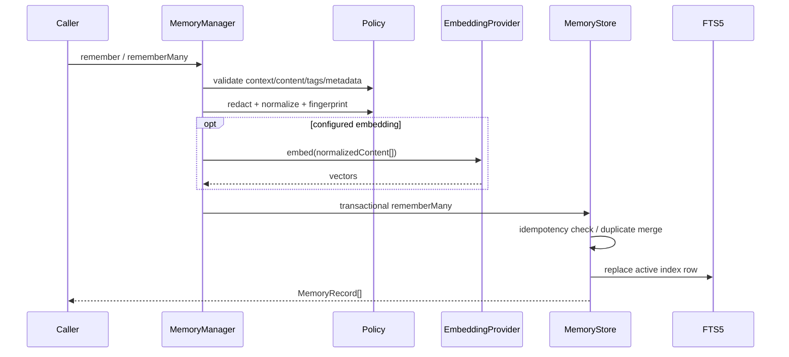
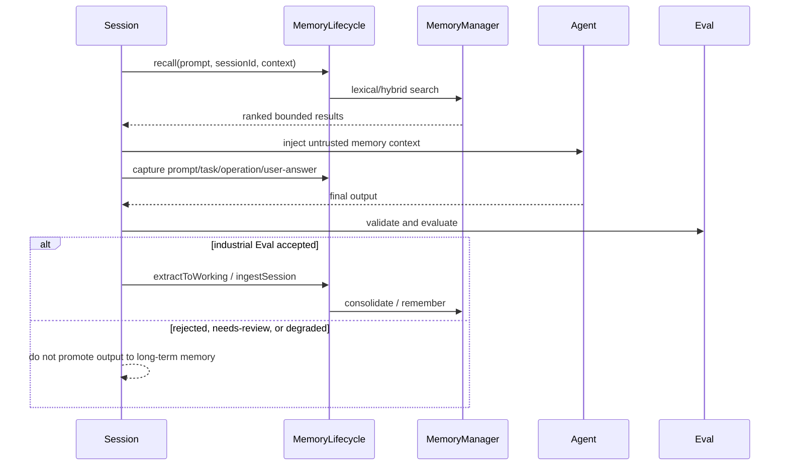

# Memories

`@yiku/memories` provides Agents with persistent, scoped, explainable long-term memory, along with Store, Policy, retrieval, reranking, and context rendering capabilities independent of the Agent SDK.

## Data Flow



## Layers and Ownership

| Layer | Component | Responsibility |
| --- | --- | --- |
| Session Integration | `MemoryRuntime` | Parses the project Scope, creates the Store/Manager/Lifecycle, applies the failure mode |
| Lifecycle | `MemoryLifecycle` | Coordinates Working Memory, extraction, consolidation, unified search, and forgetting |
| Domain Services | `MemoryManager` | Validation, redaction, Embedding, retrieval, reranking, and long-term record operations |
| Persistence | `SqliteMemoryStore` | Transactions, FTS5, vector BLOBs, Revision, TTL, and deletion |
| Short-Term State | `WorkingMemoryStore` | Saves the current Session's Prompts, Tasks, operations, and extraction candidates |
| Provider Ports | `MemoryExtractor` / `EmbeddingProvider` | Vendor-agnostic extraction and vector interfaces |
| Observability | Memory Event / Atomic Atom | Reports only Hash, phase, counts, mode, duration, and error codes |

`@yiku/memories` does not depend on the Agent SDK. The Orchestrator decides when to recall, extract, and consolidate; the CLI decides the default file paths and the `best-effort`/`strict` strategy.

## Context and Isolation

Every operation must provide a `MemoryContext`:

```ts
{
  namespace: "tenant-1",
  scope: {
    userId: "user-1",
    agentId: "code",
    projectId: "project-1",
    sessionId: "session-1",
  },
}
```

`namespace` is required. Scope fields are optional, but queries can only occur within the range allowed by the requesting context. The storage layer uses a stable Scope Key and Namespace Hash to prevent different users, projects, or Agents from recalling each other's data.

Scope matching follows the rule that "a record can be broader than the request, but not narrower": when a field in a record is `null`, the record can apply to any corresponding request under that Namespace; when a record has a specific `userId`, `agentId`, `projectId`, or `sessionId`, the request must carry the same value. `namespace` is always matched exactly. This rule allows project-level facts to enter Sessions within the project, but prevents Session-specific records from leaking into another Session.

## Writing

```ts
import {
  MemoryManager,
  SqliteMemoryStore,
} from "@yiku/memories";

const manager = new MemoryManager({
  store: new SqliteMemoryStore({
    filePath: "/absolute/path/to/memories.sqlite",
  }),
});

await manager.remember({
  confidence: 0.95,
  content: "Prefer concise engineering explanations.",
  context: {
    namespace: "tenant-1",
    scope: { projectId: "project-1", userId: "user-1" },
  },
  importance: 0.8,
  kind: "preference",
});
```

The write flow includes normalization, Secret redaction, content limits, Policy, Fingerprint, idempotency Hash, and Revision checks. The same idempotent input does not generate duplicate records.

The complete write pipeline:



The deduplication key is `namespace + scopeKey + kind + fingerprint`. When the same content is written again, Tags/Metadata are merged, the higher Confidence/Importance is taken, the record is restored to Active, and the Revision is incremented. An explicit `idempotencyKey` is unique within a Namespace; the same Key with the same Hash returns the original record, and the same Key with different content returns `MEMORY_IDEMPOTENCY_CONFLICT`. Updates require `expectedRevision`; when it does not match, `MEMORY_REVISION_CONFLICT` is returned.

## Memory Kind and Runtime Classification

The persistent Store uses five `MemoryKind` values, projected into three runtime categories:

| Runtime Category | Persistent Kind | Description |
| --- | --- | --- |
| `scenario` | `decision`, `episode` | Scenarios, experiences, and decision context |
| `procedure` | `procedure` | Repeatable steps and operational knowledge |
| `semantic` | `fact`, `preference` | Facts, concepts, and stable preferences |

Classification only affects recall explanation and Atomic Flow; it does not change the SQLite Schema or query Scope.

## Memory Extraction JSON Contract

The output of `OpenAIMemoryExtractor` must be a JSON array whose elements are `MemoryDraft`s. There is no top-level `data`, `memories`, or other wrapper fields; when there is no content worth saving, an empty array `[]` is returned. At most 20 entries can be returned at a time; it is recommended to output raw JSON directly, without appending explanatory text. The implementation is also compatible with a single complete `json` Markdown code block.

Complete example:

```json
[
  {
    "kind": "preference",
    "content": "用户偏好简洁、直接的工程说明。",
    "confidence": 0.96,
    "importance": 0.82,
    "tags": ["response-style", "user-preference"],
    "metadata": {
      "evidence": "explicit-user-statement",
      "appliesTo": "project"
    }
  },
  {
    "kind": "procedure",
    "content": "修改 CLI 后依次运行聚焦测试、lint 和 build。",
    "confidence": 0.9,
    "importance": 0.88,
    "expiresAt": "2027-01-01T00:00:00.000Z",
    "tags": ["cli", "verification"]
  }
]
```

### Fields

| Field | Required | Type and Constraints | Meaning |
| --- | --- | --- | --- |
| `kind` | Yes | `decision`, `episode`, `fact`, `preference`, `procedure` | The persistent type of the memory |
| `content` | Yes | Non-empty string; the default Policy allows at most 32,768 UTF-8 bytes | Standalone, reusable memory body |
| `confidence` | Yes | A finite number from `0` to `1` | Confidence in the extraction result; by default, Drafts below `0.55` are not consolidated |
| `importance` | Yes | A finite number from `0` to `1` | Value for future tasks, used for recall quality ranking |
| `expiresAt` | No | A parseable date string; RFC 3339 / ISO 8601 recommended | Memory expiration time; normalized to ISO 8601 on write |
| `tags` | No | Array of non-empty strings; at most 32 items and 128 UTF-8 bytes per item by default | Retrieval and filtering tags; deduplicated and sorted on write |
| `metadata` | No | JSON object; at most 16,384 UTF-8 bytes and nesting depth 8 by default | Structured information supplementing the source, scope of application, or evidence |

The Schema is strict: fields outside the table are not accepted. The value of `metadata` can only be a standard JSON value, i.e. a string, finite number, boolean, `null`, array, or nested object, and cannot contain `undefined`, functions, or runtime objects.

### Kind Selection

| Kind | Applicable Content | Example |
| --- | --- | --- |
| `decision` | Choices and their constraints that have been decided and must remain consistent in the future | "The project standardizes on Biome and does not introduce ESLint." |
| `episode` | Historical events, outcomes, or experiences with reuse value for the future | "The lockfile had to be regenerated after the last dependency upgrade." |
| `fact` | Stable, verifiable facts or project attributes | "The project requires Node.js 22.13.0 or later." |
| `preference` | Stable preferences of users, teams, or projects | "Users prefer concise engineering explanations." |
| `procedure` | Repeatable steps, commands, or troubleshooting methods | "Run tests for affected Packages first, then the root-level gates." |

During extraction, only persistent, reusable information is retained; temporary progress, complete Prompt/Response pairs, raw reasoning, Secrets, credentials, or one-time state are not saved. Each Draft should express a single clear fact; avoid concatenating multiple unrelated conclusions into the same `content`.

### Validation and Consolidation

1. The Extractor validates the top-level array, the maximum count, and the strict Schema of each Draft;
2. The default Policy discards Drafts with `confidence < 0.55`;
3. Candidates first enter Working Memory with the `turn-extract` source;
4. Consolidate performs content normalization, Secret redaction, Policy validation, and idempotency handling;
5. Qualified records are written to the long-term Memory Store.

If any Draft has an invalid structure, the output is not valid JSON, the count exceeds 20, or the model does not complete normally, the entire extraction fails. Whether this affects the Session is determined by the `best-effort` or `strict` configuration of `memory.failureMode`.

## Recall

```ts
const recalled = await manager.recall({
  context: {
    namespace: "tenant-1",
    scope: { projectId: "project-1", userId: "user-1" },
  },
  query: "How should responses be written?",
});
```

When no `EmbeddingProvider` is provided, SQLite FTS5 is used. After a Provider is injected, hybrid lexical and vector retrieval is enabled:

1. Each channel produces Candidates;
2. Reciprocal Rank Fusion merges the rankings;
3. `DefaultMemoryReranker` combines relevance, quality, freshness, and importance;
4. Deduplication is performed while maintaining Kind/source diversity;
5. Results are generated according to a character budget;
6. `renderMemoryContext()` outputs safe, bounded Agent Instructions.

Recall results include a score breakdown and the reasons for selection, facilitating audit.

## Store

### SQLite

`SqliteMemoryStore` provides:

- WAL;
- Schema versions and migrations;
- FTS5;
- Optional vector BLOBs;
- Transactional writes;
- Revision conflicts;
- TTL, soft delete, hard delete, and cleanup.

Node.js `>=22.13.0` is required. The `node:sqlite` module in Node 22 may output experimental warnings.

### SQLite Structure

The Schema Version is currently `1`; the core tables and indexes are as follows:

| Structure | Key Fields | Role |
| --- | --- | --- |
| `memories` | `id`, `namespace`, four-level Scope, `kind`, `content` | Primary records |
| Content-Derived Fields | `normalized_content`, `fingerprint` | Deterministic deduplication |
| Governance Fields | `status`, `expires_at`, `revision`, `access_count` | Lifecycle and concurrency control |
| Idempotency Fields | `idempotency_key`, `idempotency_hash` | Retry safety |
| Vector Fields | `embedding`, `embedding_model`, `embedding_dimensions` | Optional semantic retrieval |
| `memories_fts` | `id`, `content`, `tags` | FTS5 lexical retrieval |
| Unique Constraint | Namespace + Scope Key + Kind + Fingerprint | Prevents duplicate records in the same domain |
| Partial Unique Index | Namespace + Idempotency Key | Ensures the idempotency key is unique |

Initialization sets `foreign_keys=ON`, `journal_mode=WAL`, `synchronous=NORMAL`, `temp_store=MEMORY`, and a default 5-second Busy Timeout. New database files are set to `0600` on a best-effort basis. Migrations run inside `BEGIN IMMEDIATE` transactions; opening is refused when the on-disk Schema is newer than the version supported by the Runtime.

Writes, updates, soft deletes, hard deletes, and Prune all maintain FTS synchronously within transactions. Soft delete sets `status` to `deleted` and removes the record from FTS; hard delete directly removes the primary record and FTS rows; Prune deletes expired records and soft-deleted records older than the Cutoff.

### In-memory

`InMemoryMemoryStore` uses the same contract as the SQLite Store and is suitable for testing and short-lived hosts. Store Conformance tests ensure the two have consistent core behavior.

## Working Memory

`InMemoryWorkingMemoryStore` and Session Working Memory save short-term information for the current task. It is separate from long-term Memory:

- Does not automatically promote across Sessions;
- Can be captured from Prompt, Tool, or Agent output;
- Has an independent character budget when entering the context;
- The Runtime decides whether to retain or clean it up on completion or cancellation.

When `MemoryLifecycle` is used standalone, the default Working Store exists only within the process. The CLI uses `SessionWorkingMemoryStore`, which writes records into versioned Session State, so they can be restored with the Session. Each Session retains at most the most recent 500 Working Memory entries.

State transitions:

```text
capture -> active
active + valid draft -> consolidated -> longTermMemoryId
active + below threshold -> discarded
active + write failure -> active (reported in result.pending)
forget working record -> physically removed from Working Store
```

Capture deduplicates within the current Session by `source + normalizedContent`. Unified search by default queries Working, Scenario, Procedure, and Semantic simultaneously; Working results take priority, then results are merged by score and truncated by Fingerprint deduplication and character budget.

## Lifecycle

`MemoryManager` supports long-term record operations:

- `remember`
- `recall`
- `search`
- `update`
- `forget`
- `prune`
- `ingestSession`

On top of this, `MemoryLifecycle` provides `captureWorking`, `extractToWorking`, unified `search`, `consolidate`, unified `forget`, `status`, and `clearWorking`. `forget` supports soft delete and hard delete; `prune` physically deletes expired records and soft-deleted records older than the Cutoff. `consolidate` uses a stable Idempotency Key to write Working Drafts into the long-term Store; duplicate content is merged by the Store, preserving Revision semantics.

## Session Integration

The Orchestrator's sequence is:

1. Recall before the Agent is constructed;
2. Inject the bounded Memory Context into the Instructions;
3. Record Working Memory;
4. Perform optional Extraction after the Agent succeeds;
5. Generate structured Drafts via `MemoryExtractor`;
6. Write through the same Policy.



When the industrial Evaluation Coordinator is not enabled, output that succeeds and passes the domain Validator can directly enter the configured Memory Extraction, followed by running a compatible Eval. When industrial evaluation is enabled, long-term memory is automatically extracted only when the Completion Decision is `accepted`; although `degraded` can complete the Session, it does not automatically promote the current turn's output.

Configuration:

```yaml
memory:
  enabled: true
  extraction: true
  failureMode: best-effort
```

`best-effort` records degradation but does not stop the Session; `strict` treats Memory infrastructure errors as run failures. The Session also emits a structured `memory_operation` Progress Event, projected as an `AgentMessageEnvelope` Payload with the same name. Events contain only the Namespace Hash, operation, phase, duration, counts, mode, and error code — not the Prompt, reply, or Memory body; therefore persistent Session JSONL, Trace, and host callbacks can reconcile the same Memory lifecycle.

CLI:

```text
/memory status
/memory search <query>
/memory consolidate
/memory forget <id>
```

## Atomic Flow

The main atoms are:

```text
memory.recall
memory.search
memory.fts-search
memory.query-embedding
memory.vector-search
memory.rerank
memory.context-inject
memory.extract
memory.write
memory.forget
memory.prune
memory.consolidate
memory.working
memory.working-capture
memory.scenario
memory.procedure
memory.semantic
```

The Payload contains only the Scope Hash, counts, duration, and summaries; complete Secrets or unrestricted content are not written.

## Security

- The built-in Redactor handles common Secrets;
- Policy limits size, Kind, dates, Tags, and Metadata;
- Agent-recalled content uses explicit delimiters and untrusted-data warnings;
- Namespace and Scope are validated at both the Manager and Store layers;
- Embedding errors degrade or fail according to configuration;
- Store errors do not contain raw sensitive content.

## Failure and Degradation

| Scenario | `best-effort` | `strict` / Store Contract |
| --- | --- | --- |
| Recall/Extraction/Write failure | Emits an error event and continues the main flow | Pauses or fails the Session |
| Embedding failure with Policy `lexical` | Falls back to FTS; the event is marked Degraded | Not applicable |
| Embedding failure with Policy `error` | Throws a typed error | Throws a typed error |
| Vector Candidates exceed `maxVectorScan` | Skips the vector channel and uses lexical results | The event carries `MEMORY_VECTOR_SCAN_LIMIT` |
| Revision conflict | Does not overwrite the newer version | `MEMORY_REVISION_CONFLICT` |
| Schema too new or migration failure | Does not open the database | Explicit error; does not rebuild user data |
| AbortSignal triggered | Stops the current operation | `MEMORY_ABORTED` |

Failures of Memory observability Handlers and Atomic Flow Sinks cannot change Memory behavior; but actual Store, Policy, Extractor, and required Embedding failures must be handled explicitly according to configuration.

## Main Exports

- `MemoryManager`
- `SqliteMemoryStore` / `InMemoryMemoryStore`
- `InMemoryWorkingMemoryStore`
- `DefaultMemoryPolicy`
- `DefaultMemoryReranker`
- `renderMemoryContext` / `renderMemorySearchContext`
- `MemoryLifecycle`
- `MemoryStore` / `MemoryExtractor` / `EmbeddingProvider`
- Memory Atom, types, and typed errors

A Manager created by the caller must call `close()`.

## Validation

```bash
corepack pnpm --filter @yiku/memories build
corepack pnpm --filter @yiku/memories test
```

Storage paths are described in [Configuration and Storage](../atoms/configuration-and-storage.md).
