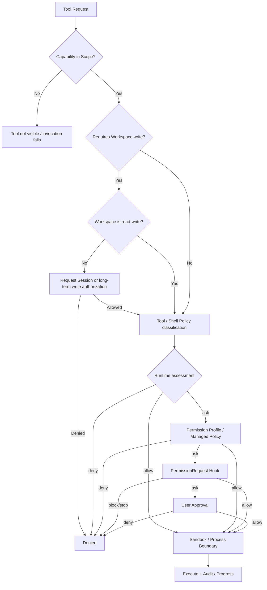

# Permissions and Execution Boundaries

Yiku's Permission system is not a boolean switch, but the intersection of Capability Scope, Workspace authorization, tool static policy, Permission Profile, Hook, human or Managed Policy approval, and the OS Sandbox. Authorization can only allow operations within existing hard boundaries; project configuration, Skills, Hooks, or Agents must not escalate privileges on their own.

## Permission Layers

| Layer | Owner | Role | Failure Semantics |
| --- | --- | --- | --- |
| Capability Scope | Orchestrator | Determines whether a tool is visible to the current Agent | Tool cannot be invoked |
| Workspace Authorization | CLI / Host | Determines whether a Workspace is read-only or read-write | Requests escalation or denies before writing |
| Workspace Boundary | `@yiku/agent-code` | Real Path, extra root directories, symlink and path escape checks | Hard denial |
| Tool/Shell Policy | `@yiku/agent-code` | Classifies operations as `allow`, `ask`, `deny` and declares Capability/Risk | `deny` does not enter approval |
| Permission Profile | `@yiku/cli` | Refines decisions by Policy, Command, MCP, and Network rules | `deny` takes precedence |
| Permission Hook | Orchestrator + Hooks | Executes `PermissionRequest` / `PermissionDenied` when approval is needed | `block`/`stop` deny |
| User / Managed Policy | CLI / Host | Gives a once, Session, or persistent decision for the remaining `ask` | Denies when no handler exists |
| Shell Sandbox | `@yiku/sandbox` | Restricts filesystem, network, and process capabilities at the OS layer | Fails explicitly or degrades in a controlled way when the platform is unavailable |

## Decision Flow



Core invariants:

- A Runtime `deny` takes effect before the Profile, Hook, or human handler is called; later layers cannot override it;
- When multiple Command/MCP rules match simultaneously, any `deny` takes precedence; otherwise the most specific wildcard rule is used;
- A Hook's `allow` can only handle requests that have already reached the Hook; it cannot override a prior hard denial;
- Workspace write authorization does not imply permission to delete, publish, escalate privileges, or run arbitrary Shell commands; these operations still require their own policies;
- The Sandbox is an execution boundary, not an approval system; even after approval, execution must stay within what the Sandbox allows.

## Permission Request Protocol

Input:

```json
{
  "toolName": "bashTool",
  "toolCallId": "call-17",
  "workspaceId": "7e813fc4b3...",
  "action": "execute command",
  "normalizedAction": "recursively remove workspace paths",
  "subject": "rm -rf ./dist",
  "policyId": "recursive-force-rm",
  "capabilities": ["process.execute", "workspace.delete"],
  "risk": "high",
  "reason": "recursively force-removes files or directories",
  "metadata": {
    "isolation": "sandbox",
    "network": "allow"
  }
}
```

Output:

```json
{
  "decision": "allow",
  "scope": "session",
  "reason": "User approved the permission for this session."
}
```

`PermissionResponse.decision` can only be `allow` or `deny`. `ask` is a pre-execution Assessment, not a final response. The allowed scopes are:

| Scope | Lifecycle | Storage |
| --- | --- | --- |
| `once` or omitted | Current request | Not persisted |
| `session` | Identical normalized requests within the current CLI process | In-memory Set |
| `persistent` | The same Policy in subsequent Sessions | The active Profile's `policyRules` |

The Session Grant Key contains the deduplicated and sorted Capability, Normalized Action, Policy ID, Risk, Tool, Workspace ID, and target. A truncated command cannot generate a Session Grant Key, to avoid using incomplete displayed content as the basis for authorization.

## Permission Profile

The configuration file is located at `~/.yiku/permission/global.json`. The default directory permission is `0700` and the file permission is `0600`; updates use a temporary file, File Sync, atomic Rename, and directory Sync. Example:

```json
{
  "_migrationVersion": 2,
  "activeProfile": "default",
  "profiles": {
    "default": {
      "displayName": "Default",
      "filesystem": { "default": "read_only" },
      "network": { "default": "allow" },
      "authorization": { "ttlDays": 7 },
      "shellSandbox": {
        "enable": true,
        "onRestrict": "request_permission_retry_sandbox"
      },
      "approval": {
        "reviewer": "user",
        "policyRules": {
          "known-low-risk-command": "allow",
          "workspace-file-write": "allow"
        },
        "commandRules": {
          "git push *": "deny"
        },
        "mcpRules": {
          "github/search_*": "allow",
          "github/delete_*": "deny"
        }
      }
    }
  },
  "resourceAuthorization": {
    "filesystem": {
      "readOnly": [],
      "readWrite": []
    },
    "network": {
      "allow": [],
      "deny": []
    }
  }
}
```

Rule values can only be `allow`, `ask`, or `deny`. Command and MCP rules support `*`; an empty Pattern does not match. Whitespace in commands is collapsed before matching. Profile parsing failures, a missing active Profile, or an invalid Schema fail closed; a default Profile is only generated when the file does not exist. The legacy v1 built-in `default` Profile is migrated to Network Default `allow`, and custom Profiles' network decisions keep their original values.

The range actually consumed by the current CLI:

| Field | Current Behavior |
| --- | --- |
| `activeProfile`, `approval.*Rules` | Matches Tool Policy, Command, and MCP Target in interactive mode |
| `network.default` | Handles requests containing only `process.execute`/`network.connect` |
| `authorization.ttlDays` | Computes the Workspace authorization expiration time |
| `resourceAuthorization.filesystem` | Restores Workspace Read-only/Read-write Trust at startup |
| `filesystem.default`, `shellSandbox.*`, `resourceAuthorization.network` | Currently only validated and persisted; not yet directly driving CLI Runtime assembly |

Therefore, you cannot assume the runtime boundaries have changed just by modifying Profile fields that are not yet wired up. Shell Isolation/Network is still determined by the Sandbox injected by the Toolset and the Shell Policy. Non-interactive mode uses the `external` Policy Mode: a Profile's `deny` can still tighten decisions, but `allow` cannot replace an explicit Managed Policy Grant.

## Workspace Authorization

Workspace authorization records store both the lexical path and the `rootRealPath`; queries match against the normalized real path. The default TTL is 7 days, and expired records do not take effect; when the same path is upgraded to read-write, the old read-only record is removed. Interactive CLIs obtain authorization before startup; non-interactive CLIs exit directly when no existing authorization is present.

The `WorkspaceAccessController` requests an upgrade the first time an edit or Shell write occurs in a read-only Session. Concurrent upgrade requests share the same Promise; once allowed, the current Controller becomes `read-write`. The persistence choice is written back to the Profile Store by the CLI, while the Session choice only affects the current process.

## Shell Policy

`ShellPolicy` uses a structured Shell Parser to inspect command segments, redirections, dynamic values, and paths, rather than performing only string prefix matching. The main classifications are:

| Decision | Typical Policy | Examples |
| --- | --- | --- |
| `deny` | `host-privilege`, `disk-format`, `raw-device-write`, `remote-shell-pipe`, path escape | `sudo`, `mkfs`, `curl ... \| sh` |
| `ask` | Deletion, moving, Git discard, recursive permission changes, publishing, Opaque/Complex Shell | `rm -rf`, `git reset --hard`, `pnpm publish` |
| `allow` | Classified read-only commands, safe build commands, limited Workspace writes, policy-permitted network | `rg`, `git status`, `pnpm test`, `touch` |

Commands that reference paths outside the Workspace, dynamic paths, or symlink escapes are hard-denied. Only the `~/.yiku` roots explicitly added by the host are accessible in Yiku Home; this does not mean the entire user Home is accessible.

## Sandbox and Degradation

- macOS uses `sandbox-exec` Profiles;
- Linux uses rootless `bubblewrap`, mounting Runtime paths read-only and mounting the working directory according to Workspace Access;
- Windows returns an unavailable error until a Job Object/ACL Sandbox is implemented;
- `@yiku/sandbox` itself does not perform command parsing, approval, or process management;
- Code Terminal can be explicitly provided a `HostPolicyShellSandbox` by the host as a degraded boundary; after degradation, `ShellPolicy` is rebuilt and `runtime_boundary_changed` is emitted;
- Verification Commands require their declared read-only or isolated execution constraints; normal Session authorization is not treated as verification isolation.

## Hooks, MCP, and Non-Interactive Mode

Tool Requests that require approval first enter the `PermissionRequest` Hook. A Hook `block`/`stop` denies immediately; a Hook `allow` can approve when `forceHumanApproval` is not enabled; other cases are handed to the user handler. After a denial, a `PermissionDenied` Hook is emitted. Hook Trust uses a separate Store and cannot be replaced by a Permission Profile.

MCP side effects use the `mcp-external-side-effect` Policy and can be matched by `mcpRules` via `server/tool`. Skill and Agent configurations must also first pass the MCP Target Allowlist and Capability Scope.

Non-interactive mode does not pop up approvals. It uses Workspace Trust plus explicit Managed Policy:

- Deny Rules take precedence;
- All requested Capabilities must be exactly authorized;
- Credential, External Request, Publish, and MCP Grants must carry a Resource;
- Resources do not support wildcards;
- Truncated commands, unknown Capabilities, or missing Grants remain `ask` and ultimately fail as requiring human input;
- Successful authorizations must be written to a private NDJSON Audit; when the Audit write fails, high-risk operations are not executed.

## Failure Handling

| Scenario | Behavior |
| --- | --- |
| Runtime Policy is `deny` | Throws `PermissionDeniedError` without calling the approval handler |
| No approval handler | Defaults to `deny` |
| Corrupted Profile file | Startup fails; requires an explicit Reset |
| Expired Workspace authorization | Treated as unauthorized |
| Sandbox startup failure | Returns a stable error; whether to degrade is decided by the caller |
| Permission Hook denial | Returns Deny and emits `PermissionDenied` |
| Long-term authorization write failure | The current operation must not masquerade as having persistent authorization |
| Agent/Skill requests privilege escalation | Denied at the Capability or Workspace boundary |

## Validation

```bash
corepack pnpm --filter @yiku/agent-code test
corepack pnpm --filter @yiku/sandbox test
corepack pnpm --filter @yiku/agent-orchestrator test
corepack pnpm --filter @yiku/cli test
```

Storage locations are described in [Configuration and Storage](../atoms/configuration-and-storage.md), tool ownership in [Code Agent](code-agent.md), and cross-package boundaries in [Package Boundaries](../architecture/package-boundaries.md).
