# Research Agent

`@yiku/agent-research` defines the evidence-based Research Agent, Research Skill, Evidence/Claim Ledger, report validation, Research Eval, and domain Flow. Running, cancellation, Sessions, and Subagents are the Orchestrator's responsibility.

## Operating Requirements

- The model and Provider support the OpenAI Responses API;
- The Provider supports Web Search;
- A valid API Key is configured;
- Provider network access is allowed when real-time retrieval is needed.

## Standard Creation

Standard hosts register and run via `ResearchAgentFactory`:

```ts
import {
  createRegisteredAgent,
  ResearchAgentFactory,
  run,
} from "@yiku/agent-orchestrator";

const model = "your-web-search-capable-model";
const created = createRegisteredAgent(
  new ResearchAgentFactory({ searchContextSize: "medium" }),
  {
    agentName: "Research Agent",
    handoffs: [],
    model,
    tools: [],
    workspaceDir: process.cwd(),
  },
  {
    agentId: "research",
    agentKey: "research",
    agentType: "research",
  },
);

const result = await run(created.agent, "研究 Agent 可观测性的最新实践", {
  apiKey: process.env.OPENAI_API_KEY ?? "",
  model,
});
```

Direct construction of `ResearchAgent` suits custom hosts; Yiku Sessions should prefer the Factory to automatically obtain a stable identity, a domain Observer, and output validation.

## Research Skill

`createResearchSkill()` creates independent instances on every construction:

- Web Search Tool;
- `EvidenceLedger`;
- `ResearchClaimLedger`;
- `recordEvidenceTool`;
- `recordClaimTool`;
- Research Prompt and stop conditions.

Ledgers are not shared between Runs, avoiding cross-contamination of concurrent research.

The `Research Skill` here is the Research Agent's domain capability bundle, not a general-purpose `SKILL.md` on disk. A standard CLI Session combines the two: the Research Factory creates the Web Search, Evidence, and Claim tools, and the Orchestrator then injects the general-purpose Skill Runtime tools.

## Loading General-Purpose Skills

In the CLI, the Research Agent uses the same discovery directories and priorities as the Code Agent:

```text
@yiku/agent-orchestrator/src/skills/builtin/<name>/SKILL.md
~/.yiku/skills/<name>/SKILL.md
<workspace>/.yiku/skills/<name>/SKILL.md
```

Loading chain:

```mermaid
flowchart LR
    files["SKILL.md"] --> discovery["discoverSkills()"]
    discovery --> runtime["SkillRuntime Catalog"]
    runtime --> runtimeSkill["createSkillRuntimeSkill(research)"]
    runtimeSkill --> scope["CapabilityScope: skills"]
    scope --> agentGraph["Agent Graph"]
    agentGraph --> factory["ResearchAgentFactory"]
    factory --> agent["ResearchAgent"]
```



1. At CLI startup, discover and parse `SKILL.md`, deduplicating by `project > user > builtin`.
2. The Catalog persistently holds name, description, source, Digest, and `agentTypes`; the body does not enter the Prompt by default.
3. The Research Agent gains `skillListTool`, `skillInspectTool`, and `skillRunTool`.
4. On automatic matching, the body is Inspected first; when `/skill-name` is explicitly activated, the Runtime first validates `agentTypes` and MCP Policy.
5. `skillRunTool` generates an immutable Snapshot and executes it in a separate read-only Worker with `agentType: research`.

Skills runnable by the Research Agent must be declared explicitly:

```markdown
---
name: source-audit
description: 核验研究来源的权威性、独立性和时效性。
agentTypes:
  - research
---

先检查原始来源，再检查独立交叉来源；证据不足时保留不确定性。
```

Omitting `agentTypes` defaults to supporting only `code`, and Research activation returns `SKILL_AGENT_TYPE_MISMATCH`. List and Inspect can display the metadata of incompatible Skills but cannot activate or run them. Research does not load Code Workspace tools by default.

`playground/research-agent` is another kind of low-level host: it creates the `ResearchAgentFactory` directly, and the Quick/Research/Deep Skills on the page are host presets plus additional instructions that do not scan the general-purpose `SKILL.md` directories above.

## Evidence

`EvidenceLedger` stores normalized source records:

- URL and canonical URL;
- Title, source domain, and source type;
- Summary and supporting content;
- Publication time, access time, and freshness information;
- Supporting or refuting relationship with Claims;
- Validation status and Metadata.

URLs are normalized through `canonicalResearchUrl()` to remove negligible differences and identify duplicate sources. Up to 50 canonical URLs are stored by default; exceeding the cap or invalid input throws a typed error.

## Claim

`ResearchClaimLedger` stores structured claims:

- Stable Claim ID;
- Claim text;
- Importance;
- Supporting Evidence IDs;
- Refuting Evidence IDs;
- Conflicts and validation status.

Up to 200 Claims are stored by default. Important facts in a report must first enter the Claim Manifest, and citation integrity is then checked by the Citation Validator. A model cannot bypass the Ledger merely by generating plausible-looking URLs.

## Report Validation

`validateResearchReport()` combines the report, Evidence, and Claim Manifest to deterministically check:

- Citation Precision and Recall;
- Unsupported Claim;
- Source authority;
- Source freshness;
- Independent domain diversity;
- Conflict and counter-evidence coverage;
- Report structure.

Semantic entailment that cannot be determined can be delegated to an optional Judge, but a Judge does not replace structured evidence. Validation failures preserve the original report and diagnostics for display by Eval, the CLI, and the Observatory.

## Research Evals

The Research Provider provides:

- `ResearchClaimCitationEvaluator`
- `ResearchContradictionEvaluator`
- `ResearchDiversityEvaluator`
- `ResearchFreshnessEvaluator`
- `ResearchReportStructureEvaluator`
- `ResearchSourceAuthorityEvaluator`
- `createResearchEvalProfile()`
- `createResearchEvaluators()`

The default configuration requires at least two independent source domains, a freshness window of 180 days, and a quality threshold of 0.8. Configuration can be adjusted per Profile, but missing Evidence cannot be treated as passing.

## Domain Flow

The `ResearchFlowTracker` emits automatically in the standard Factory:

| Atom | Meaning |
| --- | --- |
| `research.plan` | Research plan |
| `research.query` | Query construction |
| `research.search` | Web Search |
| `research.evidence-record` | Evidence recording |
| `research.corroborate` | Cross-verification and counter-evidence |
| `research.synthesize` | Comprehensive synthesis |
| `research.citation-validate` | Citation validation |
| `research.report` | Final report |

Callers do not need to listen to SDK Progress Events to manually reconstruct the flow. Domain atoms and general-purpose Tool/Model/Agent atoms enter the same Atomic Flow Run.

## Prompt Constraints

The default Prompt requires:

- Defining the research question and scope first;
- Prioritizing primary, official, and authoritative sources;
- Recording Evidence before forming key Claims;
- Proactively searching for counter-evidence and conflicts;
- Distinguishing facts, inferences, and unknowns;
- Downgrading conclusions with insufficient evidence;
- Using verifiable Citations;
- Generating a structured report once the stop conditions are met.

`loadResearchPrompt()` prefers reading the in-package Markdown template and falls back to the built-in Fallback when it is missing or empty.

## Playground

`playground/research-agent` provides a multi-turn Research UI, Thread/Turn Store, Evidence display, domain Flow, and Observatory deep links. It is an integration example, not public API of `@yiku/agent-research`.

Development:

```bash
corepack pnpm --filter @yiku/research-agent-playground dev
```

## Main Exports

- `ResearchAgent`
- `createResearchSkill`
- `EvidenceLedger`
- `ResearchClaimLedger`
- `recordEvidenceTool`
- `recordClaimTool`
- `canonicalResearchUrl`
- `validateResearchReport`
- `ResearchFlowTracker`
- `RESEARCH_ATOMS`
- Research Eval Profile, Evaluator, and Artifact Helper

## Boundaries and Failures

- The Research Agent provides no Code Workspace write tools.
- Web Search results must go through Evidence recording; the search text itself is not trusted evidence.
- URL deduplication does not prove source independence; independent domains and source types are judged separately by the Evaluator.
- Creation or running fails when the Provider does not support Web Search.
- Ledger caps, illegal URLs, unknown Evidence references, and duplicate IDs fail explicitly.
- Output validation failure prevents the standard Session from completing; the diagnostic report is still retained.
- Network and Provider failures do not fake report success.

## Verification

```bash
corepack pnpm --filter @yiku/agent-research build
corepack pnpm --filter @yiku/agent-research test
```

For evaluation strategy, see [Evals](evaluations.md); for the run projection, see [Atom Catalog](../atoms/atom-catalog.md).
