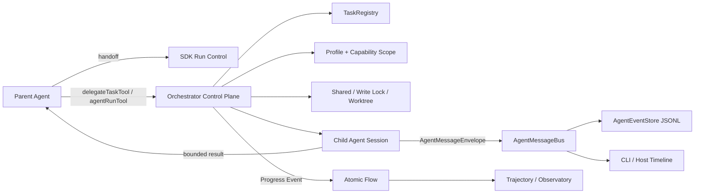
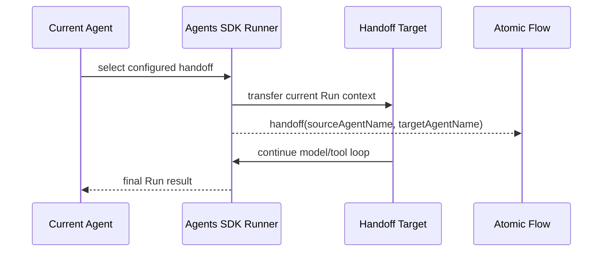
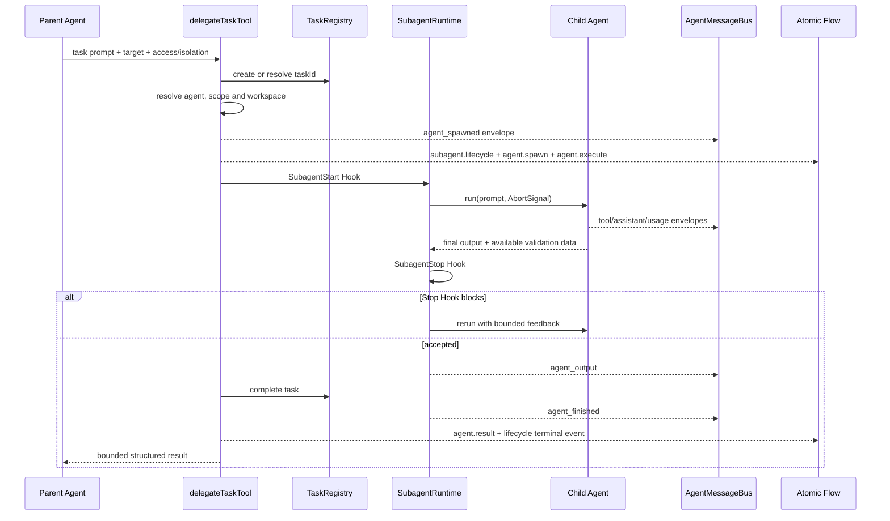
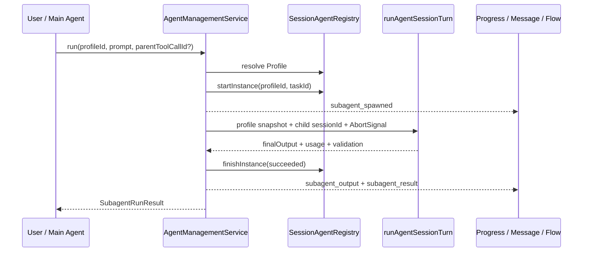

# Agent-to-Agent and Subagents

Yiku provides three collaboration mechanisms: Handoff, configured Delegate, and Session Subagent. They share the Agent Factory and run-observation capabilities, but differ in lifecycle, control, and persistence semantics.

## Mechanism Selection

| Mechanism | Defined in | Lifecycle | Parent Agent behavior | Suitable scenarios |
| --- | --- | --- | --- | --- |
| Handoff | Agent Graph | Current SDK Run | Transfers control | Specialized routing |
| Delegate | `agents.items.*.delegates` | Current Tool Call | Continues after waiting for the result | Parallel analysis, review, research |
| Session Subagent | Profile Store | Profile persisted by source; Instance per run | Explicit creation and running | Reusable expert roles |

## Overall Agent-to-Agent Model

Yiku's Agent-to-Agent (A2A) collaboration is divided into a control plane, data plane, and observation plane:



- Handoff transfers the current speaking Agent within a single SDK Run and does not create an independent Task or child Session;
- Delegate runs with the Agent Key from the configuration and a `TaskRegistry` Task; Session Subagent runs with a persistent Profile and a `SessionSubagentInstance`. Both generate Agent, Task, and message correlation IDs;
- Agents do not directly access another Agent's hidden state. Input is passed through Prompt/Task, and output is returned through structured results;
- Capability, permissions, Hook, Workspace, and domain Validators are reapplied at the child Agent's run boundary; whether an independent Eval runs is configured by the specific call path;
- A2A messages serve correlation and display, while Atomic Flow serves Run-level facts and Replay; neither is a substitute for the other.

## Three Collaboration Flows

### Handoff



A Handoff Target must appear in the current Agent's `handoffs`. Graph construction rejects cycles; target nodes use their own Agent Type, Model, Skill, and domain Tool configuration. Handoff does not return a `DelegateTaskResult` for the parent Agent to continue reasoning with, because control has already been transferred.

### Configured Delegate



`SubagentStop`'s `block` does not indicate a terminal failure; instead, the Reasons are passed as feedback and the child Agent is called again. Cancellation, exceptions, and final success close the Lifecycle. The parent AbortSignal is passed to child runs and Worktree operations. The wait queues of the current Reader `ConcurrencyLimiter` and `WorkspaceWriteLock` are themselves not cancellable; once a queued task gains execution rights, the child run must observe the same Signal again.

### Session Subagent



Session Subagent does not go through the `SubagentRuntime`'s `SubagentStart`/`SubagentStop` retry loop; it is managed by `AgentManagementService`, which manages Profile and Instance and runs an Agent Turn with a separate `agentSessionId`. On failure or cancellation, the Instance is first written to the corresponding terminal state, and then `subagent_result` is emitted.

## Configuring Delegate

```yaml
agents:
  default: code
  items:
    code:
      type: code
      model: code
      skills: [code, delegate]
      delegates: [reviewer, researcher]
    reviewer:
      type: code
      model: code
      skills: [code]
    researcher:
      type: research
      model: research
      skills: []
```

`delegateTaskTool` may only invoke targets declared by the current Agent. The input contains the task, access mode, and isolation strategy; the result contains the target Agent, output, verification summary, and Worktree information.

Input:

```json
{
  "agent_key": "reviewer",
  "prompt": "Review the permission boundary and report concrete findings",
  "access_mode": "read-only",
  "isolation": "shared",
  "task_id": "task-review-permission"
}
```

Only `agent_key` and `prompt` are required; `access_mode` defaults to `read-only`. Read-only tasks cannot request `worktree`. Read-write tasks prefer creating a Worktree when a Worktree Manager is configured and `shared` is not explicitly selected; when an automatic Worktree is unavailable, it can fall back to shared writes, but an explicit `worktree` failure does not fall back.

Output:

```json
{
  "taskId": "task-review-permission",
  "output": "Review complete...",
  "changedFiles": [],
  "verification": {
    "passed": true,
    "checks": [
      { "key": "scope", "passed": true, "summary": "No boundary escape" }
    ]
  }
}
```

Worktree mode can also return `worktreeId` and `patch`. If a read-only Delegate reports file changes, the entire call fails.

## Delegate Access Modes

### Read-only

- Can read the Workspace;
- Cannot modify files;
- Suited to review, search, and analysis;
- Limited by `maxParallelReaders`.

### Shared Read-Write

- Uses the same Workspace as the parent Agent;
- Writes are serialized through `WorkspaceWriteLock`;
- Cannot guarantee conflict-free semantic modifications across different Agents;
- Suited to short tasks with a clearly divided file scope.

### Worktree

- Executes in an independent Git Worktree;
- Returns a change summary and Patch;
- The parent Agent decides whether to apply the result;
- Cleans up the temporary Worktree on close.

Worktree requires a valid Git repository and a creatable temporary path. Uncommitted changes, submodules, externally generated files, and large repositories increase Patch and cleanup risk.

## Session Profile

Session Subagent is described by `SessionSubagentProfile`:

- `profileId` and name;
- Agent Type, model, and instructions;
- Purpose and Invocation Mode;
- Workspace Scope;
- Skill Snapshot;
- Project or user source;
- Creation and update times.

A running Profile holds the full Skill Snapshot. Project- or user-level Markdown Profiles currently persist only Skill names; on process restart, the Snapshot is rebuilt from the current Catalog, so once the corresponding `SKILL.md` is modified, deleted, or shadowed, existing persistent Profiles may change semantics or fail to load. This is the current persistence boundary, and Markdown Profiles should not be treated as frozen capability artifacts.

Profile and Instance are separated:

- A Profile is a reusable definition;
- An Instance is the state of a particular run;
- One Profile can create multiple Instances;
- An Instance records Agent ID, Task, status, output, and errors.

State relationship:

```text
Profile 1 ---- * Instance 1 ---- 1 Task
                          \---- 1 Child Agent Session
```

Profiles are limited to 12; names are deduplicated case-insensitively. A running Profile cannot be deleted. Instance states are `running -> succeeded | failed | cancelled`; terminal states record `endedAt`, and failures or cancellations may record a safe error summary.

## Creation and Management

CLI:

```text
/agent-new
/agents
```

Persistent Profiles enter `/` completion candidates as `/agent:<name>`; the text after the command serves as the task Prompt, defaulting to the Profile's Deliverable when absent.

On the Agent side, the built-in `agents` Skill can request creating, listing, running, and deleting Profiles. Under the hood, this is jointly implemented by:

- `AgentCreationBroker`
- `SessionAgentRegistry`
- `AgentManagementService`
- `SubagentRuntime`
- `ProjectAgentProfileStore` / `UserAgentProfileStore`

Profile input is validated against Schema, Agent Type, model, Skill, and Workspace Scope. Project content cannot create permissions beyond the host Policy.

## Invocation Mode

A Profile can restrict how it is invoked:

- `manual`: runs only when the user or Main Agent explicitly names the Profile;
- `proactive`: when the current user exchange matches Purpose/Scope/Trigger, the Main Agent may invoke it proactively; explicit naming is equally valid.

Purpose describes responsibilities such as review, implementation, and research; it does not directly grant Capabilities. Actual capabilities always come from the intersection of Agent Type, Skill Snapshot, MCP allowlist, and Workspace Access.

## Concurrency

`TeamRuntime` manages multiple Workers, and `TaskRegistry` manages task states. Main rules:

- Read-only Workers can run in parallel, with the count limited by the Runtime budget;
- Shared Writers execute through a single write lock;
- Worktree Writers isolate the filesystem but still share model, network, and external service budgets;
- When a parent task is cancelled, the AbortSignal propagates to associated child runs; calls already in the Reader/Writer wait queue still need to wait until they gain execution rights, after which the child run observes the cancellation;
- Child task output must complete its own Validator before aggregation.

Parallelism does not automatically resolve logical dependencies. The parent Agent should provide child tasks with an explicit Scope, input, completion criteria, and output format.

## Output Validation

Child Agents still execute the domain Output Validator provided by their Factory. Configured Delegate returns a `DelegateTaskResult`: `output`, `taskId`, `changedFiles`, plus optional `patch`, `worktreeId`, and `verification`. Session Subagent returns a `SubagentRunResult`: `agentId`, `profileId`, `taskId`, `finalOutput`, `status`, plus optional `usage` and `validation`.

Session Subagents created via the CLI currently explicitly disable independent Eval, to avoid mistaking a child run for the top-level completion gate; domain Validators remain in effect. Configured Delegate can return a Verification summary via the host's Run Adapter. Failed results cannot serve as verified Deliverables, but diagnostics can be preserved through error events and Task states.

## Permissions and Hooks

- Child Agents do not inherit undeclared Skills;
- Workspace Scope can only narrow the parent scope;
- Read-only child Agents still require a permission upgrade to write;
- High-risk Shell, MCP, and external Hooks continue to go through host approval;
- Subagent Start/Stop, Tool, Task, and Worktree lifecycles enter the Hook Engine;
- A Hook `allow` cannot override a Runtime `deny`.

## Atomic Flow

Standard collaboration events include:

- `agent.profile`
- `agent.spawn`
- `agent.execute`
- `agent.result`
- `subagent.lifecycle`
- `task.snapshot`

Child Agents correlate to the top-level Run through stable `agentId`, `taskId`, `parentToolCallId`, and the Parent Instance. Research Atoms or custom Atoms emitted by domain Observers continue into the same Flow.

## A2A Message Protocol

The canonical transport object for cross-Agent events is `AgentMessageEnvelope`:

```json
{
  "eventId": "event-42",
  "occurredAt": "2026-08-20T10:00:00.000Z",
  "sessionId": "session-root",
  "agentId": "agent-child-1",
  "agentSessionId": "session-root.agent.agent-child-1",
  "parentAgentId": "root",
  "parentToolCallId": "call-17",
  "taskId": "task-review-permission",
  "toolCallId": "read-3",
  "payload": {
    "kind": "tool_output",
    "toolName": "readTool",
    "title": "Read file",
    "summary": "Read packages/agents/code/src/permission/types.ts",
    "effect": "read"
  }
}
```

### Correlation Fields

| Field | Semantics | Stable scope |
| --- | --- | --- |
| `eventId` | Single message identity | Globally unique |
| `sessionId` | Top-level parent Session | Consistent across the entire A2A tree |
| `agentId` | Current execution instance | A single child Agent Run |
| `agentSessionId` | The child Agent's logical Session | A single child Agent Run |
| `parentAgentId` | Direct parent Agent | The current parent-child relationship |
| `parentToolCallId` | The Tool Call that triggered the Delegate/Agent Run | Used to attach to the parent Timeline and Flow Parent |
| `taskId` | Business task identity | Task Registry lifecycle |
| `toolCallId` | A Tool Call inside the child Agent | A single tool invocation |
| `payload.profileId` | Reusable Agent definition | Across multiple Instances; not a top-level Envelope field |

These IDs are not interchangeable. In particular, `profileId` is not a run instance, `agentSessionId` is not the top-level `sessionId`, and `parentToolCallId` expresses only call correlation, not Task ownership.

### Payload Lifecycle

Child Agents use the following dedicated Payloads:

```text
agent_spawned -> agent_output -> agent_finished
```

During a run, `assistant_delta`, `reasoning`, `tool_called`, `tool_output`, `usage`, `memory_operation`, and `runtime_boundary_changed` may also be sent. `agent_output` is the final consumable text, and `agent_finished` is the terminal state; on failure or cancellation there may be no `agent_output`, but there must be a terminal state and an optional error summary.

The compatibility names in `AgentProgressEvent` are:

| Envelope Payload | Progress Event | Atomic Flow |
| --- | --- | --- |
| `agent_spawned` | `subagent_spawned` | `subagent.lifecycle`, `agent.spawn`, `agent.execute` Start |
| `agent_output` | `subagent_output` | `agent.execute` Delta |
| `agent_finished` | `subagent_result` | `agent.execute`/`subagent.lifecycle` End or Error, `agent.result` |

Adapters project between the two representations. When the Message Bus has already published a native child-Agent Envelope, the same legacy Progress Event must not be republished as a second lifecycle message.

### Ordering and Delivery

- The Message Bus publishes serially for the same `agentId`, preserving that Agent's message order;
- Queues for different Agents can run in parallel, so arrival order cannot be used to infer cross-Agent causality;
- Required Sinks execute before Optional Sinks, and a Required Sink failure causes the publish to fail;
- Optional Sink and Listener failures only enter diagnostics and do not change Agent results;
- `AgentEventStore` appends JSONL with `0600` and writes according to the publish queue;
- Atomic Flow provides a strictly increasing `sequence` within a top-level Run; cross-system correlation should use IDs, not borrowed wall-clock time;
- Payloads and Atomic Summaries should be bounded. Full large results are passed via Artifact, Patch, or Store Reference.

## Data Ownership and Propagation

| Data | Producer | Consumer | Persistence / Delivery |
| --- | --- | --- | --- |
| Task Prompt | Parent Agent / User | Child Agent | Tool Input or Agent Run Input |
| Profile / Skill Snapshot | Agent Registry | Child Factory | Session State + Snapshot |
| Tool Progress | Child Runtime | Host / Timeline | `AgentMessageEnvelope` |
| Final Output | Child Agent | Parent Agent | `DelegateTaskResult.output` / `SubagentRunResult.finalOutput` |
| Validation / Verification | Child Factory / Run Adapter | Parent Agent | Structured Result fields |
| Changed Files / Patch | Worktree Manager | Parent Agent | Worktree Result, not automatically applied |
| Lifecycle Fact | Orchestrator | Replay / Observatory | Atomic Flow Event |

A parent Agent does not automatically obtain the child Agent's full Transcript, Memory, or internal reasoning. Information needed for reuse must enter the final output, structured Artifact/Verification, or be written through an explicit Memory lifecycle; this avoids implicit shared state and permission bypasses.

## Failure and Recovery

| Situation | Behavior |
| --- | --- |
| Unknown Delegate | Configuration or Tool validation failure |
| Reader reaches the concurrency cap | Enters a FIFO wait queue; the current queue wait itself is not cancellable |
| Writer conflict | Waits for the write lock; can be cancelled |
| Explicit Worktree creation failure | Child task fails, with no fallback to shared writes |
| Automatic Worktree selection but Git unavailable | Falls back to Shared and remains protected by the single write lock |
| Child Agent Validator failure | Diagnostics preserved, result marked failed |
| Parent task cancellation | Cancellation propagates and child resources are closed |
| Process exits after external side effects | Enters Review on resumption |
| Profile Snapshot corruption | Session resumption fails; not silently rebuilt |

## Usage Recommendations

- Use read-only Delegates by default for code review and repository understanding.
- Split modification tasks by directory or file ownership to avoid overlapping shared writes.
- Use Worktree when artifacts need isolation or modifications are high-risk.
- Research uses the Research Agent Type; do not fabricate Web Evidence for the Code Agent.
- Profile instructions should include responsibilities, inputs, stop conditions, output format, and forbidden behaviors.
- Check the Validator, Eval, and Artifact of child task results before the parent Agent uses them.

## Public Entry Points

- `delegateTaskTool`
- `AgentCreationBroker`
- `SessionAgentRegistry`
- `AgentManagementService`
- `SubagentRuntime`
- `TeamRuntime`
- `WorktreeManager`
- Profile, Instance, Task, and Result types

## Verification

```bash
corepack pnpm --filter @yiku/agent-orchestrator test
corepack pnpm --filter @yiku/cli test
```

For Runtime relationships, see [Runtime and Orchestration](../architecture/runtime-and-orchestration.md); for execution authorization, see [Permission and Execution Boundaries](permissions.md); for event facts and derived views, see [Atomic Flow](../atoms/atomic-flow.md) and [Trajectory](../atoms/trajectory.md).
